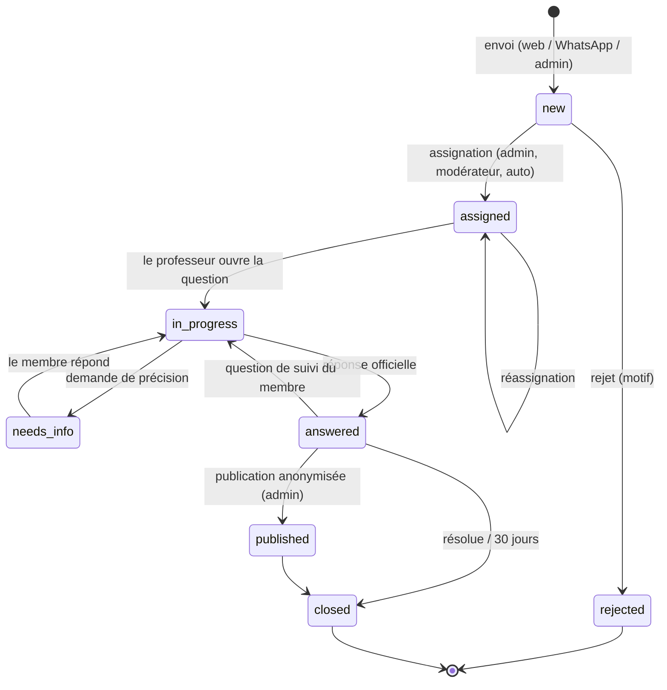
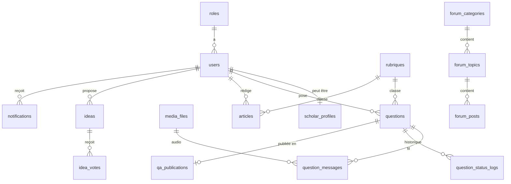

# Cahier des charges — Darul Fatwa (دار الفتوى)

> **Réponses islamiques authentiques** · أجوبة إسلامية موثوقة · *Authentic Islamic Answers*

| Élément | Valeur |
|---|---|
| Projet | Plateforme web de questions/réponses islamiques **Darul Fatwa** |
| Technologies imposées | **PHP 8.2+** (sans framework lourd) · **MySQL 8 / MariaDB 10.6+** |
| Langues | Français (par défaut) · Arabe (RTL) · Anglais |
| Maître d'ouvrage / développeur | Idrissa Diallo — Bamako, Mali |
| Version du document | 1.0 — 16 octobre 2026 |
| Statut | Prêt pour le développement avec Claude Code |

---

## Sommaire

0. [Mode d'emploi avec Claude Code](#0-mode-demploi-avec-claude-code)
1. [Présentation du projet](#1-présentation-du-projet)
2. [Acteurs, rôles et permissions](#2-acteurs-rôles-et-permissions)
3. [Rubriques (thématiques)](#3-rubriques-thématiques)
4. [Fonctionnalités détaillées](#4-fonctionnalités-détaillées)
5. [Arborescence du site](#5-arborescence-du-site)
6. [Page d'accueil — sections](#6-page-daccueil--sections)
7. [Multilinguisme FR / AR / EN](#7-multilinguisme-fr--ar--en)
8. [Charte graphique et logo](#8-charte-graphique-et-logo)
9. [Architecture technique](#9-architecture-technique)
10. [Base de données (schéma SQL complet)](#10-base-de-données-schéma-sql-complet)
11. [Routes et URL](#11-routes-et-url)
12. [Sécurité et confidentialité](#12-sécurité-et-confidentialité)
13. [SEO, performance, accessibilité](#13-seo-performance-accessibilité)
14. [Charte éditoriale et conformité religieuse](#14-charte-éditoriale-et-conformité-religieuse)
15. [Exigences non fonctionnelles](#15-exigences-non-fonctionnelles)
16. [Hébergement et déploiement](#16-hébergement-et-déploiement)
17. [Plan de développement par phases](#17-plan-de-développement-par-phases)
18. [Tests et recette](#18-tests-et-recette)
19. [Livrables](#19-livrables)
20. [Évolutions futures (V2+)](#20-évolutions-futures-v2)
- [Annexe A — CLAUDE.md à placer à la racine](#annexe-a--claudemd-à-placer-à-la-racine)
- [Annexe B — Prompts Claude Code par phase](#annexe-b--prompts-claude-code-par-phase)
- [Annexe C — Exemple de fichiers de langue](#annexe-c--exemple-de-fichiers-de-langue)
- [Annexe D — Contenus par défaut (bannières, pages)](#annexe-d--contenus-par-défaut)
- [Annexe E — Glossaire](#annexe-e--glossaire)

---

## 0. Mode d'emploi avec Claude Code

1. Créer un dossier `darul-fatwa/` et y placer :
   - ce fichier dans `docs/CAHIER_DES_CHARGES.md` ;
   - le dossier `logo/` fourni dans `public/assets/img/logo/` (les favicons dans `public/assets/img/favicons/`) ;
   - le contenu de l'**Annexe A** dans `CLAUDE.md` à la racine.
2. Ouvrir le dossier dans Claude Code et développer **une phase à la fois** (section 17), avec les prompts de l'**Annexe B**.
3. Une phase n'est terminée que lorsque **tous ses critères d'acceptation** sont vérifiés. Claude Code coche les cases de la checklist de la phase dans ce document.
4. Toute décision technique qui s'écarte de ce document est notée dans `docs/DECISIONS.md` (date, décision, raison).

> **Priorité absolue du projet : la question par message vocal**, simple et fiable sur téléphone (Android et iPhone), y compris avec une connexion lente.

---

## 1. Présentation du projet

### 1.1 Identité

| | Français | العربية | English |
|---|---|---|---|
| Nom | Darul Fatwa | دار الفتوى | Darul Fatwa |
| Slogan | Réponses islamiques authentiques | أجوبة إسلامية موثوقة | Authentic Islamic Answers |
| Titre HTML (`<title>`) | Darul Fatwa – دار الفتوى \| Réponses islamiques authentiques | دار الفتوى \| أجوبة إسلامية موثوقة | Darul Fatwa \| Authentic Islamic Answers |

Nom de domaine : à réserver (ex. `darulfatwa.com` / `darul-fatwa.org` selon disponibilité).

### 1.2 Contexte

Beaucoup de fidèles (au Mali, en Afrique de l'Ouest et dans la diaspora) ont des questions sur la foi et la pratique, mais :

- n'ont pas toujours un savant accessible près de chez eux ;
- sont plus à l'aise à l'**oral** qu'à l'écrit (langue, niveau d'alphabétisation, habitude de WhatsApp) ;
- veulent une réponse **fiable, sourcée et confidentielle**.

Darul Fatwa met en relation ces fidèles avec des **professeurs (savants, oustaz)** validés par l'administration, sur une plateforme web multilingue, avec réponse sur le site et/ou sur **WhatsApp**.

### 1.3 Objectifs

1. Permettre de **poser une question en vocal** (fonction n° 1) ou par écrit, en 3 étapes maximum.
2. Garantir une **réponse authentique** : uniquement par des professeurs validés, avec références (Coran, Hadith, ouvrages).
3. Offrir à chaque membre un **espace personnel** pour suivre ses questions (en attente / répondue).
4. Donner aux administrateurs un **suivi complet** : qui a posé quoi, sur quel thème, quand, qui a répondu, en combien de temps.
5. Diffuser le savoir : **blog**, **base publique de questions-réponses** (anonymisée), **forum**, **boîte à idées**.
6. Être disponible en **français, arabe et anglais**.

### 1.4 Public cible

- Fidèles francophones, arabophones et anglophones, majoritairement **sur mobile** (Android d'entrée de gamme, connexion 3G/4G).
- Professeurs / érudits (souvent sur mobile également).
- Équipe d'administration et de modération.

### 1.5 Périmètre

| Inclus en V1 | Hors périmètre V1 (voir section 20) |
|---|---|
| Site web responsive + PWA légère (installable) | Applications natives Android / iOS |
| Questions vocales et écrites, réponses texte et vocales | Transcription automatique des vocaux (IA) |
| WhatsApp niveau 1 (liens `wa.me`, sans API) | WhatsApp Cloud API (prévue en V2, architecture préparée) |
| Blog, Q/R publiques, forum, idées, contact | Dons / paiements en ligne |
| Back-office complet, statistiques, exports | Interface en bambara (prévue, voir 20) |

---

## 2. Acteurs, rôles et permissions

| Rôle (`roles.slug`) | Description |
|---|---|
| Visiteur (non connecté) | Consulte le site, le blog, les Q/R publiques, le forum (lecture). Doit créer un compte pour poser une question. |
| `member` — Membre | Pose des questions (vocal/texte), suit ses questions, commente, participe au forum, propose et vote des idées. |
| `scholar` — Professeur | Répond aux questions des rubriques qui lui sont attribuées, rédige des articles, valide des réponses du forum. |
| `moderator` — Modérateur | Modère forum, commentaires, idées ; trie et assigne les questions. |
| `admin` — Administrateur | Gère tout le contenu, les utilisateurs, les professeurs, les paramètres, voit toutes les statistiques. |
| `superadmin` — Super-admin | Comme admin + gestion des administrateurs, paramètres sensibles (WhatsApp, SMTP), sauvegardes. |

### 2.1 Matrice des permissions

| Action | Visiteur | Membre | Professeur | Modérateur | Admin |
|---|:-:|:-:|:-:|:-:|:-:|
| Lire blog, Q/R publiques, forum | ✅ | ✅ | ✅ | ✅ | ✅ |
| Poser une question (vocal/texte) | ❌ (invité à s'inscrire) | ✅ | ✅ | ✅ | ✅ |
| Voir **ses** questions et réponses | – | ✅ | ✅ | ✅ | ✅ |
| Voir les questions des autres | ❌ | ❌ | Seulement celles assignées / de ses rubriques | ✅ (sans notes internes privées) | ✅ |
| Répondre officiellement à une question | ❌ | ❌ | ✅ | ❌ | ✅ (si aussi professeur) |
| Assigner / réassigner une question | ❌ | ❌ | S'auto-attribuer (si autorisé) | ✅ | ✅ |
| Publier une Q/R anonymisée | ❌ | ❌ | Proposer | ❌ | ✅ |
| Rédiger un article | ❌ | ❌ | ✅ (brouillon → validation) | ❌ | ✅ |
| Créer un sujet / répondre au forum | ❌ | ✅ | ✅ | ✅ | ✅ |
| Marquer « Réponse validée par un professeur » (forum) | ❌ | ❌ | ✅ | ❌ | ✅ |
| Proposer / voter une idée | ❌ | ✅ | ✅ | ✅ | ✅ |
| Modérer (forum, commentaires, idées) | ❌ | ❌ | ❌ | ✅ | ✅ |
| Gérer utilisateurs, rubriques, bannières, pages | ❌ | ❌ | ❌ | ❌ | ✅ |
| Paramètres sensibles, administrateurs | ❌ | ❌ | ❌ | ❌ | Super-admin |

Les permissions sont centralisées dans `app/Config/permissions.php` (tableau `rôle => [permissions]`) et vérifiées par un helper `can('questions.answer')` et un middleware `RoleMiddleware`.

---

## 3. Rubriques (thématiques)

Rubriques **dynamiques** (gérées dans le back-office, avec sous-rubriques possibles). Données initiales (seed) :

| # | Code (`rubriques.code`) | Français | العربية | English | Icône suggérée |
|---|---|---|---|---|---|
| 1 | `tawhid` | L'Unicité de Dieu (Tawhid) | التوحيد | The Oneness of God (Tawhid) | étoile à 8 branches |
| 2 | `islam` | L'Islam | الإسلام | Islam | mosquée / coupole |
| 3 | `coran` | Le Coran | القرآن الكريم | The Holy Quran | livre ouvert sur pupitre (rehal) |
| 4 | `hadiths` | Les Hadiths | الحديث النبوي الشريف | Hadith | rouleau / parchemin |
| 5 | `prophete` | Le Prophète Mohammad (ﷺ) | النبي محمد ﷺ | Prophet Muhammad (ﷺ) | coupole et minaret (Médine), **jamais de représentation figurative** |
| 6 | `baya` | La Baya (les six serments) | البيعة | Bay'ah (the six oaths) | deux mains / pacte |

- Les **descriptions** de chaque rubrique (FR/AR/EN) et l'intitulé arabe complet de la rubrique Baya (« les six serments ») sont **à fournir et valider par les professeurs** ; des textes provisoires neutres sont prévus dans le seed.
- Chaque rubrique possède : nom, slug, description, icône (SVG), couleur d'accent, image, ordre, statut actif, champs SEO — pour chaque langue.
- Une sous-rubrique hérite de l'icône de son parent si aucune n'est définie.

---

## 4. Fonctionnalités détaillées

### 4.1 Comptes et authentification

**Inscription** (formulaire court, mobile d'abord) :

| Champ | Règle |
|---|---|
| Nom complet | Obligatoire, 2–120 caractères |
| Pseudonyme public | Optionnel (utilisé dans le forum et pour l'anonymat) |
| Téléphone | Obligatoire **ou** e-mail ; format international E.164, indicatif **+223** pré-sélectionné, sélecteur de pays |
| E-mail | Obligatoire **ou** téléphone ; unique |
| Numéro WhatsApp | Case « Mon numéro WhatsApp est le même » cochée par défaut |
| Mot de passe | 8 caractères minimum, indicateur de robustesse, confirmation |
| Langue préférée | FR / AR / EN (pré-remplie avec la langue courante) |
| Pays / ville | Optionnels (statistiques) |
| Genre | Optionnel (certaines questions de pratique en dépendent) |
| Consentement | Case obligatoire CGU + politique de confidentialité |
| Anti-robot | Cloudflare Turnstile (ou reCAPTCHA v3) + champ piège (honeypot) |

**Connexion** : identifiant = e-mail **ou** téléphone + mot de passe ; « Se souvenir de moi » (jeton sécurisé 30 jours) ; blocage temporaire après 5 échecs en 15 minutes (par identifiant et par IP).

**Vérification** : lien de vérification par e-mail si e-mail fourni. Vérification du téléphone par code OTP WhatsApp prévue en V2 (champ `phone_verified_at` déjà présent).

**Mot de passe oublié** : lien par e-mail (jeton haché, valable 60 minutes, usage unique). Sans e-mail : demande via WhatsApp à l'administration (V1), OTP WhatsApp (V2).

**Compte** : modification du profil, photo, changement de mot de passe, déconnexion de toutes les sessions, **export de mes données** (JSON/ZIP), **suppression du compte** (suppression des questions privées, conservation des Q/R déjà publiées car anonymisées).

### 4.2 Poser une question — module central

#### 4.2.1 Parcours

Accès : bouton doré « **Poser une question** » dans l'en-tête, dans le Hero, dans la section « Question vocale » de l'accueil, et bouton flottant micro sur mobile.

- Visiteur non connecté → page « Connectez-vous ou créez un compte » puis **retour automatique** au formulaire (paramètre `redirect`).
- Formulaire en **3 étapes** (assistant, barre de progression, utilisable d'une main sur mobile) :

| Étape | Contenu |
|---|---|
| 1. Thème | Choix de la rubrique (grandes cartes avec icônes) ; sous-rubrique si disponible |
| 2. Ma question | Onglet **🎙 Vocal (par défaut, mis en avant)** ou **✍️ Écrit**. Les deux peuvent être combinés (vocal + précision écrite). Titre court optionnel. Langue parlée dans le vocal : Français, Arabe, Anglais, **Bambara**, Autre. Option : **joindre un fichier audio existant** (ex. note vocale WhatsApp `.ogg/.opus`, `.m4a`, `.mp3`). |
| 3. Réception de la réponse | Langue souhaitée pour la réponse ; canal : **Sur la plateforme** / **Sur WhatsApp** / **Les deux** ; numéro WhatsApp (pré-rempli, modifiable) ; visibilité : **Privée** (par défaut) ou « J'accepte qu'elle soit publiée **anonymement** si elle peut aider d'autres personnes » ; récapitulatif + bouton **Envoyer** |

- Après envoi : page de confirmation avec la **référence** `DF-AAAA-NNNNNN` (ex. `DF-2026-000123`), le délai indicatif de réponse, un bouton « Suivre ma question » et un bouton « Envoyer aussi sur WhatsApp » (voir 4.3).
- Notification in-app + e-mail de confirmation (si e-mail).
- Brouillon : le texte saisi est conservé en `localStorage` (try/catch) ; l'enregistrement audio en cours est conservé en mémoire/IndexedDB jusqu'à l'envoi pour éviter une perte en cas de coupure.
- Limite anti-abus : 5 questions par 24 h par membre (paramétrable).

#### 4.2.2 Enregistreur vocal — spécifications

Composant JavaScript autonome `public/assets/js/voice-recorder.js` (ES module, sans dépendance obligatoire), réutilisé pour : questions, précisions, réponses des professeurs, forum.

| Exigence | Détail |
|---|---|
| Contrôles | Gros bouton micro (≥ 72 px) **Enregistrer** → **Pause / Reprendre** → **Arrêter** ; **Réécouter** ; **Supprimer et recommencer** |
| Retour visuel | Minuteur `mm:ss`, forme d'onde / vu-mètre en temps réel (Web Audio `AnalyserNode`), animation pulsée pendant l'enregistrement |
| Durée | Minimum 2 s, maximum **5 min** (paramètre `voice_max_seconds`), alerte à 30 s de la fin, arrêt automatique |
| Taille | Maximum 10 Mo (paramètre) |
| Format cible | **MP3 mono 64 kb/s** (≈ 0,5 Mo/min), lisible sur tous les navigateurs |
| Encodage | **Côté navigateur** : capture `getUserMedia` → `AudioWorklet` → encodage MP3 dans un **Web Worker** (bibliothèque `lamejs` ou fork maintenu, hébergée localement). Aucun besoin de `ffmpeg` sur le serveur (compatible hébergement mutualisé). |
| Repli | Si l'encodage MP3 n'est pas possible : `MediaRecorder` natif (`audio/webm;codecs=opus` ou `audio/mp4` selon `MediaRecorder.isTypeSupported`), fichier stocké tel quel et marqué `conversion_status = 'pending'` (convertible plus tard si `ffmpeg` devient disponible, ex. VPS). |
| Envoi | Upload `multipart/form-data` via `XMLHttpRequest` avec **barre de progression**, 3 tentatives automatiques en cas d'échec réseau, message clair si hors ligne |
| Permissions | HTTPS obligatoire ; message pédagogique si le micro est refusé (avec aide spécifique Android Chrome / iPhone Safari) |
| Accessibilité | Boutons libellés (`aria-label`), contrôle clavier, textes traduits FR/AR/EN, compatible RTL |
| Lecture | Lecteur audio personnalisé (play/pause, barre de progression, vitesse 0,75× / 1× / 1,25× / 1,5× / 2×) ; option : WaveSurfer.js pour l'affichage de la forme d'onde |

Côté serveur (`AudioService`) : vérification du type réel (`finfo`), de la taille et de la durée, nom de fichier aléatoire (UUID), stockage **hors du dossier public** (`storage/audio/AAAA/MM/`), calcul du SHA-256, enregistrement dans `media_files`. Diffusion uniquement via `GET /media/audio/{uuid}` après contrôle d'accès, avec **prise en charge des requêtes HTTP Range (206 Partial Content)**, indispensable à la lecture et au déplacement dans l'audio sur Safari/iOS.

#### 4.2.3 Cycle de vie (statuts)

| Statut technique | Libellé membre | Description |
|---|---|---|
| `new` | En attente | Question reçue, pas encore assignée |
| `assigned` | En attente | Assignée à un professeur |
| `in_progress` | En cours de traitement | Le professeur a ouvert / commencé la réponse |
| `needs_info` | Précision demandée | Le professeur demande une précision au membre |
| `answered` | Répondue ✅ | Réponse officielle envoyée |
| `published` | Répondue ✅ (publiée anonymement) | Une version anonymisée est publiée dans la base publique |
| `rejected` | Non retenue | Hors sujet, doublon ou inappropriée (motif obligatoire, visible par le membre) |
| `closed` | Clôturée | Clôturée par le membre (« Ma question est résolue ») ou automatiquement 30 jours après la réponse |



- Toute transition passe par `QuestionWorkflow::transition($question, $to, $actor, $comment)` qui **valide la transition**, met à jour les horodatages (`assigned_at`, `answered_at`, `first_response_minutes`), écrit dans `question_status_logs` et `activity_logs`, et déclenche les notifications.
- Le fil d'une question (`question_messages`) contient : la question initiale, les précisions, les demandes d'information, la réponse officielle, les questions de suivi et les **notes internes** (visibles uniquement par l'équipe).

#### 4.2.4 Réponse du professeur

- Réponse **texte** (éditeur riche simplifié : gras, italique, listes, citation, bloc « verset » avec mise en forme arabe) et/ou **vocale** (même enregistreur).
- **Références structurées** (ajout par formulaire, affichage normalisé) :
  - Coran : sourate (liste des 114 sourates FR/AR/EN) + verset(s) ;
  - Hadith : recueil (Bukhari, Muslim, Abu Dawud, Tirmidhi, Nasa'i, Ibn Majah, Muwatta, Ahmad, autre) + numéro + degré d'authenticité (champ libre) ;
  - Ouvrage : titre, auteur, page.
- Langue de la réponse (FR, AR, EN, bambara pour le vocal).
- **Relecture** : si le professeur a l'option « relecture obligatoire », la réponse passe en `review_status = 'pending'` et n'est envoyée au membre qu'après validation par un admin.
- Bouton « **Répondre via WhatsApp** » (voir 4.3) et bouton « **Proposer à la publication** » (titre et question reformulés, sans aucune donnée personnelle).

### 4.3 Intégration WhatsApp

L'intégration est conçue derrière une interface unique `App\Services\WhatsApp\WhatsAppGateway` pour passer du niveau 1 au niveau 2 sans réécrire le reste du code.

#### Niveau 1 — V1 (gratuit, sans API) : `LinkGateway`

| Fonction | Fonctionnement |
|---|---|
| Bouton flottant WhatsApp (toutes les pages) | Lien `https://wa.me/<numéro officiel>?text=<message prérempli traduit>` |
| « Envoyer ma question via WhatsApp » (après envoi ou à la place du formulaire) | Message prérempli : « Assalamou alaykoum, voici ma question pour Darul Fatwa — Réf. DF-2026-000123 — Rubrique : Coran ». Le membre envoie ensuite sa note vocale directement dans la discussion. |
| Import d'un vocal reçu sur WhatsApp | Dans le back-office, sur la fiche question : « Importer un audio reçu sur WhatsApp » (upload `.ogg/.opus/.m4a/.mp3`), ou « Créer une question depuis WhatsApp » (recherche du membre par numéro, sinon création d'un compte invité) avec `source = 'whatsapp'` |
| « Répondre via WhatsApp » (professeur) | Ouvre `https://wa.me/<numéro du membre>?text=<résumé + lien vers la réponse complète>`. Le professeur peut joindre sa note vocale depuis son téléphone. Au retour, il clique « Marqué comme envoyé sur WhatsApp » → `sent_via_whatsapp_at` + journal. |

Les numéros des membres ne sont **jamais affichés en entier** aux professeurs sauf si le membre a choisi le canal WhatsApp pour cette question.

#### Niveau 2 — V2 : `CloudApiGateway` (WhatsApp Business Platform – Cloud API de Meta)

- Prérequis : compte Meta Business vérifié, numéro dédié à la plateforme, application Meta, **modèles de messages (templates) approuvés** pour les messages envoyés hors de la fenêtre de service client de 24 h. Conditions et tarifs Meta à vérifier au moment de la mise en place.
- Notifications automatiques : « Votre question DF-… a reçu une réponse » (template, FR/AR/EN) avec lien.
- **Webhook entrant** `POST /webhooks/whatsapp` : vérification de la signature `X-Hub-Signature-256` (secret de l'application), réception des messages texte et **audio** → téléchargement du média via l'API Graph → création ou rattachement automatique d'une question au membre identifié par son numéro. `GET /webhooks/whatsapp` pour la vérification (`hub.verify_token`).
- Envoi de la réponse vocale via l'API dans la fenêtre de 24 h.
- Journalisation complète dans `whatsapp_messages` ; envois via la file `message_queue` (cron) avec reprise sur erreur.
- Paramètres (back-office, super-admin) : numéro officiel, `phone_number_id`, `waba_id`, jeton d'accès, `app_secret`, `verify_token`, activation du niveau 2.

### 4.4 Espace membre (« Mon espace »)

| Section | Contenu |
|---|---|
| Tableau de bord | Compteurs : questions posées / répondues / en attente ; dernières réponses reçues ; raccourci « Poser une question » ; notifications récentes |
| Mes questions | Liste avec badges de statut colorés, filtres (statut, rubrique, période), recherche par référence ou mot-clé, pagination. Onglets rapides : **Toutes · En attente · Répondues · Précision demandée** |
| Détail d'une question | Mon audio et/ou mon texte, rubrique, date, canal choisi, statut + chronologie ; **réponse officielle** (texte + audio + références) avec nom et photo du professeur ; bouton « Ajouter une précision » (texte/vocal) ; « Ma question est résolue » ; « Cette réponse m'a aidé » (oui/non) ; bouton « Recevoir sur WhatsApp » |
| Favoris | Articles et Q/R publiques enregistrés |
| Forum | Mes sujets, mes messages, mes abonnements |
| Mes idées | Idées proposées, statut, votes |
| Notifications | Liste complète, tout marquer comme lu, préférences (e-mail, WhatsApp, in-app) |
| Profil et sécurité | Infos, photo, langue, canal préféré, mot de passe, sessions, export de données, suppression du compte |

### 4.5 Espace professeur

| Section | Contenu |
|---|---|
| Tableau de bord | Questions assignées (par statut), non assignées dans ses rubriques, réponses ce mois-ci, délai moyen de réponse, questions en retard (> 72 h, paramétrable) |
| File de travail | « Mes questions » et « À prendre » (si l'auto-attribution est autorisée) ; tri par ancienneté, rubrique, langue, type (vocal/texte) |
| Fiche question | Demandeur (pseudonyme ou nom, langue, pays, genre si renseigné), audio avec vitesse de lecture, texte, champ **transcription manuelle** (optionnel, utile pour la publication), historique complet, autres questions du même membre (titres seulement) |
| Actions | Répondre (texte / vocal / références) · Demander une précision · Note interne · Demander une réassignation (avec motif) · Répondre via WhatsApp · Proposer à la publication |
| Mes articles | Rédiger des articles de blog (brouillon → soumis → publié par un admin) |
| Profil public | Photo, titre (Cheick, Oustaz, Dr…), biographie FR/AR/EN, spécialités (rubriques), langues parlées — affiché sur la page « Nos professeurs » |

### 4.6 Back-office (administration)

#### 4.6.1 Tableau de bord

- Cartes KPI : total questions, nouvelles (24 h / 7 j), en attente, en retard, répondues, **taux de réponse**, **délai moyen de première réponse**, membres inscrits (total / nouveaux), articles publiés, sujets forum, idées.
- Graphiques (Chart.js) : questions par **rubrique** (barres), par **statut** (anneau), par **langue**, par **canal** (plateforme / WhatsApp), par **type** (vocal / texte), évolution mensuelle (courbe), activité par **professeur** (tableau : assignées, répondues, délai moyen), répartition par **pays**.
- Filtre de période global (7 j, 30 j, 12 mois, personnalisé).

#### 4.6.2 Gestion complète des questions

Tableau principal (filtrable, triable, paginé, export **CSV / Excel**) :

| Colonne | Détail |
|---|---|
| Réf. | `DF-2026-000123` (lien vers la fiche) |
| Date / heure | Date de création + ancienneté (« il y a 3 h ») |
| Demandeur | **Nom complet**, téléphone, e-mail, pays (lien vers la fiche membre) |
| Rubrique | Rubrique / sous-rubrique |
| Type | 🎙 Vocal (durée) / ✍️ Texte / Mixte ; bouton lecture rapide |
| Langue | Langue parlée → langue de réponse souhaitée |
| Canal | Plateforme / WhatsApp / Les deux ; source (web / WhatsApp / admin) |
| Statut | Badge coloré |
| Assignée à | Professeur |
| Délai | Temps écoulé ou temps de réponse ; rouge si en retard |

- Filtres : statut, rubrique, langue, canal, type, professeur, période, pays, « en retard », « relecture en attente », recherche (référence, nom, téléphone, mot-clé).
- **Actions groupées** : assigner, changer de statut, exporter, supprimer (suppression logique).
- **Fiche question** : toutes les informations ci-dessus, lecteur audio, fil complet (messages, notes internes), **chronologie** de toutes les actions (qui, quoi, quand — à partir de `question_status_logs` et `activity_logs`), historique des assignations, journal WhatsApp, actions : assigner/réassigner, changer le statut, valider une réponse en relecture, rejeter (motif), publier (création d'une Q/R anonymisée), importer un audio WhatsApp.
- **Assignation automatique** (option) : à l'arrivée d'une question, attribution au professeur disponible de la rubrique et de la langue ayant le moins de questions ouvertes (sans dépasser `max_open_questions`).
- **Fiche membre** : profil, statistiques, **toutes ses questions**, ses messages forum, ses idées, son journal d'activité, actions (suspendre, bannir, réinitialiser le mot de passe, changer de rôle).

#### 4.6.3 Autres modules d'administration

| Module | Fonctions |
|---|---|
| Utilisateurs | Liste, recherche, filtres (rôle, statut, pays), création, rôle, suspension, bannissement, suppression |
| Professeurs | Fiches, rubriques, langues, charge maximale, option « relecture obligatoire », visibilité publique, ordre d'affichage |
| Rubriques | CRUD + traductions + icône SVG + couleur + ordre + sous-rubriques |
| Q/R publiques | CRUD des publications anonymisées (traductions, statut, audio de réponse) |
| Blog | Articles (CRUD multilingue, planification, image à la une, audio, SEO, mise en avant), tags, commentaires (modération) |
| Forum | Catégories, sujets (épingler, verrouiller, masquer, déplacer), messages, signalements |
| Idées | Modération, changement de statut, réponse officielle |
| Accueil | **Bannières du Hero** (CRUD multilingue, ordre, dates de début/fin, image desktop + mobile), activation et ordre des sections, verset/hadith du jour, chiffres clés (auto ou manuels) |
| Pages | À propos, CGU, Politique de confidentialité, FAQ, Charte du forum (CRUD multilingue) |
| Messages de contact | Boîte de réception, statut (nouveau, lu, répondu, archivé), réponse par e-mail |
| Newsletter | Abonnés, export CSV |
| Paramètres | Identité (nom, slogan, logos), coordonnées, réseaux sociaux, WhatsApp, SMTP, limites (durée vocale, taille, questions/jour), anti-robot, délai « en retard », mode maintenance |
| Journal d'activité | Toutes les actions sensibles (connexion admin, changement de statut, suppression, export, modification de paramètres), filtrable |
| Sauvegardes | Bouton « Sauvegarder la base maintenant » (super-admin) + liste des sauvegardes générées par cron |

### 4.7 Blog

- **Liste** : grille de cartes (image, rubrique, titre, extrait, auteur, date, temps de lecture), filtre par rubrique et tag, recherche, pagination, article mis en avant en tête, barre latérale (populaires, rubriques, newsletter).
- **Article** : titre, image, auteur (professeur, lien vers son profil), date, temps de lecture, contenu riche (avec blocs « verset » en arabe correctement mis en forme), **version audio** optionnelle, références, boutons de partage (**WhatsApp**, Facebook, X, Telegram, copier le lien), articles liés (même rubrique), commentaires (membres connectés, modération a priori), ajout aux favoris.
- Un article peut exister en 1, 2 ou 3 langues. Le sélecteur de langue mène à la traduction si elle existe, sinon à la liste du blog de la langue choisie avec un message.
- Statuts : brouillon, soumis (par un professeur), planifié, publié, archivé.

### 4.8 Base publique de questions-réponses

- Questions **anonymisées et reformulées** + réponse officielle (texte, audio éventuel, références), classées par rubrique.
- Recherche plein texte (MySQL `FULLTEXT`), filtres rubrique / langue, tri (récentes, plus consultées).
- Page de détail balisée **schema.org `QAPage`**, partage, favoris, « Poser une question similaire » (pré-sélectionne la rubrique).
- Aucune donnée personnelle (nom, numéro, voix du demandeur) n'est jamais publiée : seule la **voix du professeur** peut être publiée.

### 4.9 Forum

- Catégories par défaut : une par rubrique + « Discussions générales » + « Vie de la communauté ».
- Sujet : titre, contenu texte (+ note vocale optionnelle), rubrique, langue. Réponses, citation d'un message, « J'aime », abonnement (notifications), signalement.
- **Badge « Réponse validée par un professeur »** sur un message marqué par un professeur.
- Modération : a priori pour les 3 premiers messages d'un nouveau membre, filtre de mots interdits, épingler / verrouiller / masquer, gestion des signalements.
- Bandeau permanent : « Le forum est un espace d'échange. Seules les réponses des professeurs de Darul Fatwa ont valeur d'avis religieux. »
- Charte du forum (page dédiée) acceptée à la première participation.

### 4.10 Boîte à idées (« Poster des idées »)

- Un membre propose une idée : titre, description, catégorie (Plateforme, Contenus, Événements, Autre).
- Vote (1 par membre, annulable), commentaires, tri (populaires, récentes, statut).
- Statuts : en modération → nouvelle → à l'étude → retenue → réalisée / non retenue, avec **réponse officielle** de l'administration.

### 4.11 Contact

- Formulaire : nom, e-mail ou téléphone, sujet (liste : Question générale, Partenariat, Problème technique, Devenir professeur, Autre), message ; anti-robot + honeypot + limite de 3 envois / heure / IP.
- Coordonnées (adresse, téléphone, e-mail), bouton WhatsApp, horaires, réseaux sociaux, carte Google Maps (iframe, optionnelle).
- Enregistrement en base + e-mail à l'administration + accusé de réception à l'expéditeur.
- Rappel : « Pour une question religieuse, utilisez plutôt le bouton Poser une question. »

### 4.12 Notifications

| Événement | Destinataire | In-app | E-mail | WhatsApp (V1 lien / V2 auto) |
|---|---|:-:|:-:|:-:|
| Question reçue (confirmation) | Membre | ✅ | ✅ | V2 |
| Nouvelle question dans ma rubrique / assignée | Professeur | ✅ | ✅ | V2 |
| Précision demandée | Membre | ✅ | ✅ | V2 |
| Précision reçue | Professeur | ✅ | ✅ | – |
| **Réponse disponible** | Membre | ✅ | ✅ | ✅ (selon canal choisi) |
| Réponse à valider (relecture) | Admin | ✅ | ✅ | – |
| Question en retard | Professeur + admin | ✅ | ✅ (récapitulatif quotidien) | – |
| Réponse dans un sujet suivi | Membre | ✅ | Option | – |
| Changement de statut d'une idée | Auteur | ✅ | Option | – |
| Nouveau message de contact | Admin | ✅ | ✅ | – |

- In-app : icône cloche avec compteur dans l'en-tête (rafraîchi toutes les 60 s via `GET /api/notifications/count`).
- E-mails : **PHPMailer** (SMTP), modèles HTML aux couleurs de la charte, dans la langue du destinataire, envoyés via la file `message_queue` traitée par cron.

### 4.13 Recherche globale

Champ de recherche dans l'en-tête → page de résultats regroupés : Q/R publiques, articles, sujets du forum (MySQL `FULLTEXT`, mode booléen, repli `LIKE` pour les mots de moins de 3 lettres), dans la langue courante.

---

## 5. Arborescence du site

```
Accueil
├── Rubriques
│   ├── L'Unicité de Dieu ── (Q/R publiques + articles de la rubrique)
│   ├── L'Islam
│   ├── Le Coran
│   ├── Les Hadiths
│   ├── Le Prophète Mohammad (ﷺ)
│   └── La Baya (les six serments)
├── Questions-Réponses (base publique)
│   └── Détail d'une Q/R
├── Poser une question  (assistant 3 étapes — connexion requise)
├── Blog
│   └── Article
├── Forum
│   ├── Catégorie
│   └── Sujet
├── Idées (boîte à idées)
│   └── Détail d'une idée
├── Nos professeurs
│   └── Profil d'un professeur
├── À propos
├── Contact
├── Recherche
├── Connexion · Inscription · Mot de passe oublié
├── Mon espace (membre)
│   ├── Tableau de bord · Mes questions · Détail · Favoris
│   ├── Forum · Mes idées · Notifications · Profil
├── Espace professeur
│   ├── Tableau de bord · File de travail · Fiche question · Mes articles · Mon profil
├── Administration (back-office)
└── Pages légales : CGU · Confidentialité · Charte du forum · FAQ
```

Pages d'erreur personnalisées et traduites : 403, 404, 419 (jeton CSRF expiré), 429 (trop de requêtes), 500, page de maintenance.

---

## 6. Page d'accueil — sections

Ordre par défaut (chaque section peut être activée/désactivée et réordonnée depuis le back-office).

| # | Section | Contenu et comportement |
|---|---|---|
| 1 | **Barre supérieure** (fine, vert nuit) | Date **grégorienne + hégirienne** (via `IntlDateFormatter` calendrier `islamic-umalqura`, ex. « 5 joumada al oula 1448 AH »), téléphone, e-mail, icônes réseaux sociaux, sélecteur de langue **FR · ع · EN** |
| 2 | **En-tête** (collant au défilement) | Logo horizontal, menu : Accueil · Rubriques ▾ (méga-menu avec icônes) · Questions-Réponses · Blog · Forum · Idées · Contact ; loupe de recherche ; cloche de notifications (connecté) ; Connexion / Mon espace ; bouton doré **Poser une question**. Sur mobile : menu hamburger plein écran. |
| 3 | **Hero — bannière défilante** | Carrousel **Swiper** : 3 à 5 diapositives gérées dans le back-office ; défilement automatique toutes les 6 s, pause au survol, flèches + puces, effet fondu ; voile vert dégradé sur l'image ; titre, sous-titre, 1–2 boutons ; image desktop 1920×800 et mobile 768×960 (WebP) ; première image chargée en priorité (`fetchpriority="high"`), suivantes en différé ; prise en charge **RTL** ; respecte `prefers-reduced-motion` (pas de défilement automatique). Textes par défaut : Annexe D. |
| 4 | **Question vocale (mise en avant)** | Bloc crème à motif géométrique : grand bouton micro animé « **Appuyez, parlez, envoyez** — un professeur vous répond », sous-texte « En français, arabe, anglais ou bambara », lien secondaire « Je préfère écrire ». Le clic ouvre directement l'étape 2 de l'assistant en mode vocal (après connexion). |
| 5 | **Comment ça marche** | 4 étapes illustrées : ① Créez votre compte ② Enregistrez votre question (vocal ou écrit) ③ Un professeur qualifié vous répond avec des références ④ Recevez la réponse sur la plateforme ou sur WhatsApp |
| 6 | **Nos rubriques** | Grille de 6 cartes (3×2 desktop, 2×3 tablette, 1 colonne ou défilement horizontal mobile) : icône, nom, description courte, nombre de Q/R publiées, lien « Explorer » |
| 7 | **Dernières réponses** | 6 cartes Q/R publiques récentes (rubrique, titre, extrait, icône 🎧 si réponse audio) + bouton « Toutes les questions-réponses » |
| 8 | **Verset / Hadith du jour** | Texte arabe (police Amiri, grand corps), traduction dans la langue courante, référence ; bouton partager sur WhatsApp |
| 9 | **Articles récents du blog** | 3 cartes + bouton « Tous les articles » |
| 10 | **Nos professeurs** | Carrousel des profils publics (photo, titre, nom, spécialités) |
| 11 | **Chiffres clés** | Compteurs animés à l'apparition : questions répondues, membres, articles, professeurs |
| 12 | **Forum et idées** | Deux colonnes : derniers sujets actifs / idées les plus votées |
| 13 | **Call To Action** | Bandeau vert profond à motif géométrique doré : « Une question vous préoccupe ? Posez-la maintenant, en toute confidentialité. » Boutons : **Poser ma question** (doré) · **Écrire sur WhatsApp** · **Créer un compte** |
| 14 | **Newsletter** | Champ e-mail + bouton, double confirmation par e-mail |
| 15 | **Pied de page** (vert nuit) | 4 colonnes : ① logo blanc, slogan, présentation courte, réseaux sociaux ② Liens rapides ③ Rubriques ④ Contact (adresse, téléphone, e-mail, WhatsApp). Barre inférieure : © 2026 Darul Fatwa — Tous droits réservés · CGU · Confidentialité · Charte du forum · sélecteur de langue. Bouton « retour en haut ». |
| — | **Éléments flottants** | Bouton WhatsApp (bas à droite ; bas à gauche en arabe), bouton micro « Poser une question » sur mobile, bandeau cookies (consentement, si statistiques activées) |

---

## 7. Multilinguisme FR / AR / EN

### 7.1 Principes

| Sujet | Règle |
|---|---|
| URL | Préfixe de langue obligatoire : `/fr/…`, `/ar/…`, `/en/…`. La racine `/` redirige selon : cookie `lang` → langue du profil → en-tête `Accept-Language` → `fr` par défaut. |
| Segments d'URL | En français pour `/fr/` (ex. `/fr/poser-une-question`), en anglais pour `/en/` et `/ar/` (ex. `/ar/ask`) pour des liens partageables lisibles. Les **slugs de contenu** sont propres à chaque langue (slug arabe autorisé, encodé UTF-8). |
| Textes d'interface | Fichiers PHP `lang/{fr,ar,en}/{fichier}.php` retournant des tableaux ; helper `__('home.hero.cta')`, remplacement de paramètres `__('questions.ref', ['ref' => 'DF-…'])`, pluriels simples `trans_choice()`. Clé manquante → repli sur `fr` + entrée dans le journal (mode debug). |
| Contenus | Tables `*_translations` (une ligne par langue). Traduction absente → affichage de la langue par défaut avec un bandeau « Contenu non disponible en arabe ». |
| Langue de l'utilisateur | Enregistrée dans le profil et le cookie ; les e-mails et notifications sont envoyés dans la langue du destinataire. |
| SEO | Balises `<link rel="alternate" hreflang="fr|ar|en|x-default">` sur chaque page ; sitemap par langue. |
| Back-office | Interface d'administration en FR par défaut, traduisible avec les mêmes fichiers (AR/EN). |

### 7.2 Arabe et RTL

- `<html lang="ar" dir="rtl">` ; chargement de `bootstrap.rtl.min.css` à la place de `bootstrap.min.css`.
- CSS écrit avec les **propriétés logiques** (`margin-inline-start`, `padding-inline-end`, `inset-inline-start`, `text-align: start`) pour fonctionner dans les deux sens sans duplication.
- Icônes directionnelles (flèches, chevrons) inversées en RTL (`[dir=rtl] .icon-dir { transform: scaleX(-1); }`).
- Swiper initialisé avec `dir="rtl"` ; éditeur de texte avec direction automatique ; champs de saisie avec `dir="auto"` (un membre peut écrire en arabe sur la version française).
- Polices arabes : **Amiri** (versets, titres) et **Tajawal** (interface).
- Chiffres : chiffres occidentaux (0-9) par défaut sur toutes les langues (paramètre modifiable).
- Dates : `IntlDateFormatter` avec la locale (`fr_FR`, `ar`, `en_GB`) + date hégirienne `@calendar=islamic-umalqura`.

### 7.3 Formules et termes religieux

- Le nom du Prophète est toujours suivi de **ﷺ** (U+FDFA) dans les trois langues (option d'affichage « (PSL) » en français, paramètre).
- Glossaire de traduction partagé (Annexe E) pour garder une terminologie cohérente (Tawhid, Baya, Sunna, Fatwa…).

---

## 8. Charte graphique et logo

### 8.1 Logo (fourni)

Le logo représente une **arche / coupole** (« Dar », la maison du savoir) surmontée d'un **croissant**, contenant une **étoile à 8 branches** (Rub el-Hizb), des **ondes vocales** (la question posée à la voix, cœur du projet) qui s'élèvent d'un **Livre ouvert** (le Coran, source des réponses). Nom en latin (police Gloock) et en arabe, slogan en petites capitales. Les textes sont vectorisés : aucun besoin de police pour afficher le logo. Les fichiers **SVG** sont vectoriels (agrandissables à l'infini, à privilégier sur le site) ; des exports **PNG 4K** sont fournis pour l'impression, la vidéo et les réseaux sociaux.

| Fichier | Usage |
|---|---|
| `logo/darul-fatwa-logo.svg` / `.png` | Logo horizontal principal (en-tête, documents) |
| `logo/darul-fatwa-logo-blanc.svg` / `.png` | Version claire sur fond sombre transparent (pied de page, bandeaux verts) |
| `logo/darul-fatwa-logo-vertical.svg` / `.png` | Version verticale (page de connexion, e-mails, réseaux sociaux) |
| `logo/darul-fatwa-icone.svg` / `.png` | Icône seule (avatar réseaux sociaux, PWA) |
| `logo/4k/darul-fatwa-logo-4k.png`, `darul-fatwa-logo-blanc-4k.png`, `darul-fatwa-logo-vertical-4k.png`, `darul-fatwa-icone-4k.png` | **Exports 4K** : 3840 px de large, fond transparent (icône 3840×3840) |
| `logo/4k/darul-fatwa-logo-4k-uhd-fond-blanc.png`, `darul-fatwa-logo-4k-uhd-fond-vert.png` | Toiles **4K UHD 3840×2160** (présentations, vidéos, écrans, couvertures) |
| `logo/favicons/favicon.ico`, `favicon-16x16.png`, `favicon-32x32.png`, `apple-touch-icon.png` (180), `android-chrome-192x192.png`, `android-chrome-512x512.png` | Favicons et manifeste PWA |

Règles : zone de protection autour du logo = hauteur du croissant ; taille minimale 140 px de large (horizontal) et 24 px (icône) ; ne pas déformer, ne pas changer les couleurs hors des versions fournies.

### 8.2 Couleurs

| Rôle | Nom | Hex | Usage |
|---|---|---|---|
| Primaire | Vert profond | `#0B5D45` | Titres, liens, boutons principaux, en-tête actif |
| Primaire foncé | Vert nuit | `#073D2E` | Barre supérieure, pied de page, survols |
| Primaire clair | Vert émeraude | `#0E7356` | Dégradés, éléments secondaires |
| Accent | Or | `#C9A24B` | Bouton « Poser une question », filets, icônes, puces actives |
| Accent clair | Or clair | `#E3C77E` | Motifs, survols, détails sur fond vert |
| Fond de section | Crème | `#F7F1E1` | Sections alternées, cartes mises en avant |
| Fond | Blanc | `#FFFFFF` | Fond principal |
| Texte | Anthracite | `#1F2A26` | Texte courant |
| Texte secondaire | Gris vert | `#4A5A54` | Métadonnées, légendes |
| Succès | Vert | `#2E7D32` | Statut « Répondue » |
| Attention | Ambre | `#B7791F` | « En attente », « Précision demandée » |
| Erreur | Rouge | `#B42318` | Erreurs, « Non retenue » |
| Information | Bleu | `#1D6FA3` | « En cours » |

Accessibilité : l'or n'est **jamais** utilisé pour du texte sur fond blanc (contraste insuffisant). Bouton doré = texte vert nuit `#073D2E` sur fond `#C9A24B`. Contraste minimal AA (4,5:1) pour tout texte.

Variables CSS à définir dans `public/assets/css/variables.css` (`--df-green`, `--df-green-dark`, `--df-gold`, `--df-cream`, `--df-text`…), puis surcharge des variables Bootstrap (`--bs-primary`, etc.).

### 8.3 Typographies (Google Fonts, **hébergées localement** dans `public/assets/fonts/`)

| Usage | Latin (FR/EN) | Arabe |
|---|---|---|
| Titres | **Gloock** (cohérent avec le logo) | **Amiri** Bold |
| Texte et interface | **Inter** (400, 500, 600, 700) | **Tajawal** (400, 500, 700) |
| Versets, citations | – | **Amiri** (400, 700), corps 125 %, interligne 2 |

### 8.4 Style des composants

- Rayon des cartes 14 px, boutons 10 px ; ombres douces (`0 6px 24px rgba(7,61,46,.08)`).
- Motif géométrique islamique (étoile à 8 branches) en SVG léger, en filigrane (opacité 5 %) sur le Hero, le CTA et le pied de page.
- Icônes : **Bootstrap Icons** (interface) + 6 icônes SVG dédiées aux rubriques, dans le style du logo (trait or sur fond vert).
- Badges de statut : pastille colorée + libellé (jamais la couleur seule).
- **Aucune représentation figurative** du Prophète ﷺ, des Compagnons ou des prophètes (images, illustrations, IA). Visuels autorisés : calligraphie, architecture, géométrie, nature, manuscrits.

---

## 9. Architecture technique

### 9.1 Pile technique

| Couche | Choix | Remarques |
|---|---|---|
| Langage serveur | **PHP 8.2+** (8.3 recommandé), `declare(strict_types=1)` | Extensions : `pdo_mysql`, `mbstring`, `intl`, `fileinfo`, `gd` ou `imagick`, `openssl`, `json`, `curl`, `zip` |
| Base de données | **MySQL 8.0+** ou **MariaDB 10.6+**, InnoDB, `utf8mb4_unicode_ci` | Accès exclusivement via **PDO** et requêtes préparées |
| Architecture | **MVC maison léger** (PSR-4, Composer) | Pas de framework lourd : compatible hébergement mutualisé, simple à maintenir |
| Serveur web | Apache + `.htaccess` (mod_rewrite) ; Nginx possible | Front controller unique `public/index.php` |
| Dépendances Composer | `vlucas/phpdotenv`, `phpmailer/phpmailer`, `ezyang/htmlpurifier`, `phpoffice/phpspreadsheet`, `intervention/image`, `ramsey/uuid`, `phpunit/phpunit` (dev) | Versions stables récentes, figées par `composer.lock` |
| Front-end | HTML5, **Bootstrap 5.3** (+ build RTL), **JavaScript vanilla** (ES modules), Bootstrap Icons | **Aucune étape de build obligatoire** ; bibliothèques copiées dans `public/vendor/` |
| Bibliothèques JS | **Swiper** (Hero, carrousels), **Chart.js** (statistiques), **Quill** (éditeur riche), **lamejs** (encodage MP3), **WaveSurfer.js** (optionnel), **intl-tel-input** (téléphone) | Hébergées localement, versions figées |
| Tâches planifiées | `cron/run.php` exécuté chaque minute | File d'e-mails/WhatsApp, rappels de retard, clôture automatique, sitemap, statistiques, sauvegardes |
| Tests | PHPUnit (services, validateurs, workflow, i18n) | + recette manuelle sur mobiles réels |

### 9.2 Noyau MVC (`app/Core`)

| Classe | Rôle |
|---|---|
| `App` | Amorçage : `.env`, configuration, gestion des erreurs, session, langue, routeur |
| `Router` | Routes GET/POST/PUT/DELETE, paramètres `{id}`, `{slug}`, groupes avec préfixe et middlewares, routes nommées (`route('blog.show', [...])`), préfixe de langue |
| `Request` / `Response` | Accès sécurisé aux entrées, JSON, redirections, téléchargements, flux avec **Range** |
| `Controller` | Classe de base : `view()`, `json()`, `redirect()`, `validate()`, `authorize()` |
| `Database` | Singleton PDO (`ERRMODE_EXCEPTION`, `EMULATE_PREPARES=false`, `utf8mb4`), transactions |
| `Model` | Base : `find`, `where`, `create`, `update`, `softDelete`, `paginate` ; requêtes préparées uniquement |
| `View` | Gabarits PHP avec layouts, sections, partials ; échappement par défaut via `e()` |
| `Session`, `Flash`, `Csrf` | Session sécurisée, messages flash, jetons CSRF |
| `Auth` | Connexion, déconnexion, « se souvenir de moi », utilisateur courant, `can()` |
| `Validator` | Règles : `required`, `email`, `phone`, `min`, `max`, `in`, `unique`, `file`, `mimes`, `max_size`, `confirmed`… messages traduits |
| `Lang` | Chargement des fichiers de langue, `__()`, direction (`ltr/rtl`), hreflang |
| `Logger` | Journaux applicatifs (`storage/logs/app-AAAA-MM-JJ.log`) |
| Middlewares | `LocaleMiddleware`, `AuthMiddleware`, `GuestMiddleware`, `RoleMiddleware`, `CsrfMiddleware`, `ThrottleMiddleware`, `MaintenanceMiddleware`, `SecurityHeadersMiddleware` |

### 9.3 Arborescence du projet

```
darul-fatwa/
├── app/
│   ├── Config/            app.php, database.php, mail.php, whatsapp.php, permissions.php, upload.php
│   ├── Core/              App, Router, Request, Response, Controller, Model, View, Database,
│   │                      Session, Flash, Csrf, Auth, Validator, Lang, Logger
│   ├── Middleware/        Locale, Auth, Guest, Role, Csrf, Throttle, Maintenance, SecurityHeaders
│   ├── Controllers/
│   │   ├── Front/         Home, Rubrique, PublicQa, Question (assistant), Blog, Forum, Idea,
│   │   │                  Scholar, Page, Contact, Search, Newsletter, Media
│   │   ├── Auth/          Login, Register, Password, Verification
│   │   ├── Account/       Dashboard, MyQuestions, Favorites, Notifications, Profile
│   │   ├── Scholar/       Dashboard, Queue, Answer, Articles, Profile
│   │   ├── Admin/         Dashboard, Questions, Users, Scholars, Rubriques, PublicQa, Articles,
│   │   │                  Comments, Forum, Ideas, Banners, HomeSections, DailyQuotes, Pages,
│   │   │                  ContactMessages, Newsletter, Settings, ActivityLog, Backups, Exports
│   │   └── Api/           AudioUpload, Notifications, Likes, Votes, Favorites, WhatsAppWebhook
│   ├── Models/            User, Role, ScholarProfile, Rubrique, Question, QuestionMessage, MediaFile,
│   │                      QaPublication, Article, Tag, Comment, ForumCategory, ForumTopic, ForumPost,
│   │                      Idea, Banner, DailyQuote, Page, ContactMessage, Notification, Setting, ...
│   ├── Services/          AudioService, QuestionWorkflow, AssignmentService, NotificationService,
│   │                      MailService, QueueService, StatsService, ExportService, SlugService,
│   │                      SearchService, HijriDateService, SitemapService, BackupService,
│   │                      WhatsApp/{WhatsAppGateway.php, LinkGateway.php, CloudApiGateway.php}
│   ├── Helpers/           functions.php (e, __, route, asset, url, old, csrf_field, can, money...)
│   └── Views/
│       ├── layouts/       front.php, auth.php, account.php, scholar.php, admin.php, email.php
│       ├── partials/      header, topbar, footer, hero-slider, voice-recorder, audio-player,
│       │                  pagination, status-badge, flash, lang-switcher, whatsapp-float
│       ├── front/ auth/ account/ scholar/ admin/ emails/ errors/
├── lang/
│   ├── fr/  common.php, nav.php, home.php, auth.php, questions.php, blog.php, forum.php,
│   │        ideas.php, account.php, scholar.php, admin.php, validation.php, emails.php
│   ├── ar/  (mêmes fichiers)
│   └── en/  (mêmes fichiers)
├── public/                ← racine web (document root)
│   ├── index.php  .htaccess  robots.txt  manifest.webmanifest  sw.js
│   ├── assets/
│   │   ├── css/   variables.css, app.css, rtl.css, admin.css
│   │   ├── js/    app.js, voice-recorder.js, mp3-worker.js, audio-player.js, question-wizard.js,
│   │   │          hero-slider.js, notifications.js, admin-charts.js
│   │   ├── img/   logo/, favicons/, rubriques/, patterns/, placeholders/
│   │   └── fonts/ (Inter, Gloock, Amiri, Tajawal — woff2)
│   ├── vendor/    bootstrap/, bootstrap-icons/, swiper/, chart.js/, quill/, lamejs/, intl-tel-input/
│   └── uploads/   (images publiques : bannières, articles, avatars — PAS d'audio)
├── storage/               ← hors racine web, non accessible directement
│   ├── audio/  (AAAA/MM/uuid.mp3)   private/   cache/   logs/   exports/   backups/
├── database/
│   ├── schema.sql   seeds/01_roles.sql … 06_settings.sql   migrations/ (AAAA_MM_JJ_description.sql)
├── cron/run.php
├── bin/       install.php (création de la base + super-admin), create-admin.php, migrate.php
├── tests/     Unit/, Feature/
├── docs/      CAHIER_DES_CHARGES.md, DECISIONS.md
├── .env.example  composer.json  phpunit.xml  CLAUDE.md  README.md
```

### 9.4 Configuration (`.env.example`)

```dotenv
APP_NAME="Darul Fatwa"
APP_ENV=local            # local | production
APP_DEBUG=true
APP_URL=http://localhost:8000
APP_DEFAULT_LOCALE=fr
APP_LOCALES=fr,ar,en
APP_TIMEZONE=Africa/Bamako
APP_KEY=                 # 32 octets aléatoires (base64), généré par bin/install.php

DB_HOST=127.0.0.1
DB_PORT=3306
DB_DATABASE=darul_fatwa
DB_USERNAME=root
DB_PASSWORD=

MAIL_HOST=smtp.example.com
MAIL_PORT=587
MAIL_ENCRYPTION=tls
MAIL_USERNAME=
MAIL_PASSWORD=
MAIL_FROM_ADDRESS=contact@darulfatwa.com
MAIL_FROM_NAME="Darul Fatwa"

WHATSAPP_MODE=link        # link | cloud_api
WHATSAPP_OFFICIAL_NUMBER=+223XXXXXXXX
WHATSAPP_PHONE_NUMBER_ID=
WHATSAPP_WABA_ID=
WHATSAPP_ACCESS_TOKEN=
WHATSAPP_APP_SECRET=
WHATSAPP_VERIFY_TOKEN=

TURNSTILE_SITE_KEY=
TURNSTILE_SECRET_KEY=

VOICE_MAX_SECONDS=300
UPLOAD_AUDIO_MAX_MB=10
QUESTIONS_PER_DAY=5
QUESTION_LATE_HOURS=72
```

---

## 10. Base de données (schéma SQL complet)

### 10.1 Conventions

- Moteur **InnoDB**, jeu de caractères **`utf8mb4`**, collation `utf8mb4_unicode_ci` (arabe et émojis).
- Tables et colonnes en anglais, `snake_case` ; clés primaires `id` `INT UNSIGNED AUTO_INCREMENT`.
- Horodatages `created_at`, `updated_at` ; suppression logique `deleted_at` sur les contenus.
- Contenus multilingues : table principale + table `*_translations` (clé `(xxx_id, locale)`).
- Dates stockées en **UTC** ; affichage dans le fuseau `Africa/Bamako` (ou celui du membre).
- Relations polymorphes simples (`likes`, `favorites`, `reports`, `comments`) : colonnes `xxx_type` (ENUM) + `xxx_id`.

### 10.2 Diagramme des relations principales



### 10.3 Script `database/schema.sql`

```sql
-- =====================================================================
--  Darul Fatwa — schéma de base de données
--  MySQL 8.0+ / MariaDB 10.6+  ·  InnoDB  ·  utf8mb4
-- =====================================================================
--  Hébergement mutualisé : la base est créée depuis le panneau d'hébergement ;
--  bin/install.php ignore alors les deux instructions CREATE DATABASE / USE ci-dessous.
-- =====================================================================
SET NAMES utf8mb4;
SET FOREIGN_KEY_CHECKS = 0;

CREATE DATABASE IF NOT EXISTS darul_fatwa
  CHARACTER SET utf8mb4 COLLATE utf8mb4_unicode_ci;
USE darul_fatwa;

-- ---------------------------------------------------------------------
-- 1. Utilisateurs, rôles, sécurité
-- ---------------------------------------------------------------------
CREATE TABLE roles (
  id          TINYINT UNSIGNED NOT NULL AUTO_INCREMENT,
  slug        VARCHAR(30)  NOT NULL,
  name        VARCHAR(60)  NOT NULL,
  PRIMARY KEY (id),
  UNIQUE KEY uq_roles_slug (slug)
) ENGINE=InnoDB DEFAULT CHARSET=utf8mb4 COLLATE=utf8mb4_unicode_ci;

CREATE TABLE users (
  id                 INT UNSIGNED NOT NULL AUTO_INCREMENT,
  uuid               CHAR(36)     NOT NULL,
  role_id            TINYINT UNSIGNED NOT NULL DEFAULT 1,
  full_name          VARCHAR(120) NOT NULL,
  display_name       VARCHAR(60)  NULL,
  email              VARCHAR(190) NULL,
  phone              VARCHAR(20)  NULL,               -- format E.164 : +223XXXXXXXX
  whatsapp           VARCHAR(20)  NULL,
  password_hash      VARCHAR(255) NOT NULL,
  locale             ENUM('fr','ar','en') NOT NULL DEFAULT 'fr',
  gender             ENUM('m','f') NULL,
  country            CHAR(2)      NULL DEFAULT 'ML',
  city               VARCHAR(80)  NULL,
  avatar_path        VARCHAR(255) NULL,
  preferred_channel  ENUM('platform','whatsapp','both') NOT NULL DEFAULT 'platform',
  notify_email       TINYINT(1)   NOT NULL DEFAULT 1,
  notify_whatsapp    TINYINT(1)   NOT NULL DEFAULT 1,
  email_verified_at  DATETIME     NULL,
  phone_verified_at  DATETIME     NULL,
  forum_rules_accepted_at DATETIME NULL,
  status             ENUM('active','pending','suspended','banned') NOT NULL DEFAULT 'active',
  last_login_at      DATETIME     NULL,
  last_login_ip      VARCHAR(45)  NULL,
  created_at         DATETIME     NOT NULL DEFAULT CURRENT_TIMESTAMP,
  updated_at         DATETIME     NULL ON UPDATE CURRENT_TIMESTAMP,
  deleted_at         DATETIME     NULL,
  PRIMARY KEY (id),
  UNIQUE KEY uq_users_uuid (uuid),
  UNIQUE KEY uq_users_email (email),
  UNIQUE KEY uq_users_phone (phone),
  KEY idx_users_role (role_id),
  KEY idx_users_status (status),
  CONSTRAINT fk_users_role FOREIGN KEY (role_id) REFERENCES roles (id),
  CONSTRAINT chk_users_contact CHECK (email IS NOT NULL OR phone IS NOT NULL)
) ENGINE=InnoDB DEFAULT CHARSET=utf8mb4 COLLATE=utf8mb4_unicode_ci;

CREATE TABLE user_tokens (
  id          INT UNSIGNED NOT NULL AUTO_INCREMENT,
  user_id     INT UNSIGNED NOT NULL,
  type        ENUM('email_verify','password_reset','remember','phone_otp') NOT NULL,
  token_hash  CHAR(64)     NOT NULL,                  -- SHA-256 du jeton (jamais le jeton en clair)
  expires_at  DATETIME     NOT NULL,
  used_at     DATETIME     NULL,
  created_at  DATETIME     NOT NULL DEFAULT CURRENT_TIMESTAMP,
  PRIMARY KEY (id),
  UNIQUE KEY uq_user_tokens_hash (token_hash),
  KEY idx_user_tokens_user_type (user_id, type),
  CONSTRAINT fk_user_tokens_user FOREIGN KEY (user_id) REFERENCES users (id) ON DELETE CASCADE
) ENGINE=InnoDB DEFAULT CHARSET=utf8mb4 COLLATE=utf8mb4_unicode_ci;

CREATE TABLE login_attempts (
  id          INT UNSIGNED NOT NULL AUTO_INCREMENT,
  identifier  VARCHAR(190) NOT NULL,
  ip_address  VARCHAR(45)  NOT NULL,
  success     TINYINT(1)   NOT NULL DEFAULT 0,
  created_at  DATETIME     NOT NULL DEFAULT CURRENT_TIMESTAMP,
  PRIMARY KEY (id),
  KEY idx_login_attempts_identifier (identifier, created_at),
  KEY idx_login_attempts_ip (ip_address, created_at)
) ENGINE=InnoDB DEFAULT CHARSET=utf8mb4 COLLATE=utf8mb4_unicode_ci;

CREATE TABLE rate_limits (
  rl_key      VARCHAR(190) NOT NULL,                  -- ex. "contact:ip:1.2.3.4"
  hits        INT UNSIGNED NOT NULL DEFAULT 0,
  reset_at    DATETIME     NOT NULL,
  PRIMARY KEY (rl_key)
) ENGINE=InnoDB DEFAULT CHARSET=utf8mb4 COLLATE=utf8mb4_unicode_ci;

-- ---------------------------------------------------------------------
-- 2. Rubriques et professeurs
-- ---------------------------------------------------------------------
CREATE TABLE rubriques (
  id          SMALLINT UNSIGNED NOT NULL AUTO_INCREMENT,
  parent_id   SMALLINT UNSIGNED NULL,
  code        VARCHAR(40)  NOT NULL,                  -- identifiant stable : tawhid, islam, coran...
  icon        VARCHAR(120) NULL,                      -- chemin du SVG
  color       CHAR(7)      NULL,
  image_path  VARCHAR(255) NULL,
  sort_order  SMALLINT     NOT NULL DEFAULT 0,
  is_active   TINYINT(1)   NOT NULL DEFAULT 1,
  created_at  DATETIME     NOT NULL DEFAULT CURRENT_TIMESTAMP,
  updated_at  DATETIME     NULL ON UPDATE CURRENT_TIMESTAMP,
  PRIMARY KEY (id),
  UNIQUE KEY uq_rubriques_code (code),
  KEY idx_rubriques_parent (parent_id),
  CONSTRAINT fk_rubriques_parent FOREIGN KEY (parent_id) REFERENCES rubriques (id) ON DELETE SET NULL
) ENGINE=InnoDB DEFAULT CHARSET=utf8mb4 COLLATE=utf8mb4_unicode_ci;

CREATE TABLE rubrique_translations (
  rubrique_id      SMALLINT UNSIGNED NOT NULL,
  locale           ENUM('fr','ar','en') NOT NULL,
  name             VARCHAR(120) NOT NULL,
  slug             VARCHAR(140) NOT NULL,
  short_description VARCHAR(255) NULL,
  description      TEXT NULL,
  meta_title       VARCHAR(160) NULL,
  meta_description VARCHAR(255) NULL,
  PRIMARY KEY (rubrique_id, locale),
  UNIQUE KEY uq_rubrique_tr_slug (locale, slug),
  CONSTRAINT fk_rubrique_tr FOREIGN KEY (rubrique_id) REFERENCES rubriques (id) ON DELETE CASCADE
) ENGINE=InnoDB DEFAULT CHARSET=utf8mb4 COLLATE=utf8mb4_unicode_ci;

CREATE TABLE scholar_profiles (
  user_id             INT UNSIGNED NOT NULL,
  languages           SET('fr','ar','en','bm','other') NOT NULL DEFAULT 'fr',
  max_open_questions  SMALLINT UNSIGNED NOT NULL DEFAULT 20,
  can_self_assign     TINYINT(1) NOT NULL DEFAULT 1,
  requires_review     TINYINT(1) NOT NULL DEFAULT 0,  -- relecture obligatoire par un admin
  is_public           TINYINT(1) NOT NULL DEFAULT 1,
  is_available        TINYINT(1) NOT NULL DEFAULT 1,  -- pour l'assignation automatique
  photo_path          VARCHAR(255) NULL,
  sort_order          SMALLINT NOT NULL DEFAULT 0,
  created_at          DATETIME NOT NULL DEFAULT CURRENT_TIMESTAMP,
  updated_at          DATETIME NULL ON UPDATE CURRENT_TIMESTAMP,
  PRIMARY KEY (user_id),
  CONSTRAINT fk_scholar_user FOREIGN KEY (user_id) REFERENCES users (id) ON DELETE CASCADE
) ENGINE=InnoDB DEFAULT CHARSET=utf8mb4 COLLATE=utf8mb4_unicode_ci;

CREATE TABLE scholar_translations (
  user_id     INT UNSIGNED NOT NULL,
  locale      ENUM('fr','ar','en') NOT NULL,
  title       VARCHAR(80)  NULL,                      -- Cheick, Oustaz, Dr...
  bio         TEXT NULL,
  PRIMARY KEY (user_id, locale),
  CONSTRAINT fk_scholar_tr FOREIGN KEY (user_id) REFERENCES scholar_profiles (user_id) ON DELETE CASCADE
) ENGINE=InnoDB DEFAULT CHARSET=utf8mb4 COLLATE=utf8mb4_unicode_ci;

CREATE TABLE scholar_rubriques (
  user_id      INT UNSIGNED NOT NULL,
  rubrique_id  SMALLINT UNSIGNED NOT NULL,
  PRIMARY KEY (user_id, rubrique_id),
  KEY idx_scholar_rubriques_rubrique (rubrique_id),
  CONSTRAINT fk_sr_user FOREIGN KEY (user_id) REFERENCES scholar_profiles (user_id) ON DELETE CASCADE,
  CONSTRAINT fk_sr_rubrique FOREIGN KEY (rubrique_id) REFERENCES rubriques (id) ON DELETE CASCADE
) ENGINE=InnoDB DEFAULT CHARSET=utf8mb4 COLLATE=utf8mb4_unicode_ci;

-- ---------------------------------------------------------------------
-- 3. Fichiers (audio, images, documents)
-- ---------------------------------------------------------------------
CREATE TABLE media_files (
  id                 INT UNSIGNED NOT NULL AUTO_INCREMENT,
  uuid               CHAR(36)     NOT NULL,
  owner_id           INT UNSIGNED NULL,
  kind               ENUM('audio','image','document') NOT NULL,
  disk               ENUM('private','public') NOT NULL DEFAULT 'private',
  path               VARCHAR(255) NOT NULL,           -- relatif à storage/ ou public/uploads/
  original_name      VARCHAR(255) NULL,
  mime_type          VARCHAR(100) NOT NULL,
  size_bytes         INT UNSIGNED NOT NULL,
  duration_seconds   SMALLINT UNSIGNED NULL,
  checksum_sha256    CHAR(64)     NULL,
  conversion_status  ENUM('none','pending','done','failed') NOT NULL DEFAULT 'none',
  converted_path     VARCHAR(255) NULL,
  transcript         TEXT NULL,                       -- transcription manuelle (ou IA en V2)
  created_at         DATETIME NOT NULL DEFAULT CURRENT_TIMESTAMP,
  PRIMARY KEY (id),
  UNIQUE KEY uq_media_uuid (uuid),
  KEY idx_media_owner (owner_id),
  CONSTRAINT fk_media_owner FOREIGN KEY (owner_id) REFERENCES users (id) ON DELETE SET NULL
) ENGINE=InnoDB DEFAULT CHARSET=utf8mb4 COLLATE=utf8mb4_unicode_ci;

-- ---------------------------------------------------------------------
-- 4. Questions (module central)
-- ---------------------------------------------------------------------
CREATE TABLE questions (
  id                     INT UNSIGNED NOT NULL AUTO_INCREMENT,
  reference              VARCHAR(20)  NULL,           -- DF-2026-000123 (renseignée juste après l'INSERT)
  user_id                INT UNSIGNED NOT NULL,
  rubrique_id            SMALLINT UNSIGNED NOT NULL,
  title                  VARCHAR(200) NULL,
  input_type             ENUM('audio','text','mixed') NOT NULL,
  source                 ENUM('web','whatsapp','admin') NOT NULL DEFAULT 'web',
  spoken_language        ENUM('fr','ar','en','bm','other') NOT NULL DEFAULT 'fr',
  answer_language        ENUM('fr','ar','en','bm') NOT NULL DEFAULT 'fr',
  answer_channel         ENUM('platform','whatsapp','both') NOT NULL DEFAULT 'platform',
  whatsapp_number        VARCHAR(20)  NULL,
  visibility             ENUM('private','publishable') NOT NULL DEFAULT 'private',
  status                 ENUM('new','assigned','in_progress','needs_info','answered','published','rejected','closed')
                         NOT NULL DEFAULT 'new',
  priority               ENUM('normal','high') NOT NULL DEFAULT 'normal',
  assigned_to            INT UNSIGNED NULL,
  assigned_at            DATETIME NULL,
  answered_at            DATETIME NULL,
  first_response_minutes INT UNSIGNED NULL,
  answer_message_id      INT UNSIGNED NULL,           -- réponse officielle (FK ajoutée plus bas)
  rejection_reason       VARCHAR(255) NULL,
  user_found_helpful     TINYINT(1) NULL,
  closed_at              DATETIME NULL,
  ip_address             VARCHAR(45)  NULL,
  user_agent             VARCHAR(255) NULL,
  created_at             DATETIME NOT NULL DEFAULT CURRENT_TIMESTAMP,
  updated_at             DATETIME NULL ON UPDATE CURRENT_TIMESTAMP,
  deleted_at             DATETIME NULL,
  PRIMARY KEY (id),
  UNIQUE KEY uq_questions_reference (reference),
  KEY idx_questions_status (status, created_at),
  KEY idx_questions_rubrique_status (rubrique_id, status),
  KEY idx_questions_assigned_status (assigned_to, status),
  KEY idx_questions_user (user_id, created_at),
  CONSTRAINT fk_questions_user FOREIGN KEY (user_id) REFERENCES users (id) ON DELETE CASCADE,
  CONSTRAINT fk_questions_rubrique FOREIGN KEY (rubrique_id) REFERENCES rubriques (id),
  CONSTRAINT fk_questions_assigned FOREIGN KEY (assigned_to) REFERENCES users (id) ON DELETE SET NULL
) ENGINE=InnoDB DEFAULT CHARSET=utf8mb4 COLLATE=utf8mb4_unicode_ci;

CREATE TABLE question_messages (
  id               INT UNSIGNED NOT NULL AUTO_INCREMENT,
  question_id      INT UNSIGNED NOT NULL,
  sender_id        INT UNSIGNED NULL,
  kind             ENUM('question','answer','follow_up','info_request','internal_note') NOT NULL,
  body             MEDIUMTEXT NULL,                   -- HTML purifié (HTMLPurifier)
  media_id         INT UNSIGNED NULL,                 -- note vocale
  references_json  JSON NULL,                         -- [{"type":"quran","surah":2,"ayah_from":255,"ayah_to":255}, ...]
  language         ENUM('fr','ar','en','bm','other') NULL,
  review_status    ENUM('not_required','pending','approved','rejected') NOT NULL DEFAULT 'not_required',
  reviewed_by      INT UNSIGNED NULL,
  reviewed_at      DATETIME NULL,
  sent_via_whatsapp_at DATETIME NULL,
  read_at          DATETIME NULL,                     -- lu par le destinataire
  created_at       DATETIME NOT NULL DEFAULT CURRENT_TIMESTAMP,
  updated_at       DATETIME NULL ON UPDATE CURRENT_TIMESTAMP,
  PRIMARY KEY (id),
  KEY idx_qm_question (question_id, created_at),
  KEY idx_qm_review (review_status),
  CONSTRAINT fk_qm_question FOREIGN KEY (question_id) REFERENCES questions (id) ON DELETE CASCADE,
  CONSTRAINT fk_qm_sender FOREIGN KEY (sender_id) REFERENCES users (id) ON DELETE SET NULL,
  CONSTRAINT fk_qm_media FOREIGN KEY (media_id) REFERENCES media_files (id) ON DELETE SET NULL,
  CONSTRAINT fk_qm_reviewer FOREIGN KEY (reviewed_by) REFERENCES users (id) ON DELETE SET NULL
) ENGINE=InnoDB DEFAULT CHARSET=utf8mb4 COLLATE=utf8mb4_unicode_ci;

ALTER TABLE questions
  ADD CONSTRAINT fk_questions_answer FOREIGN KEY (answer_message_id)
      REFERENCES question_messages (id) ON DELETE SET NULL;

CREATE TABLE question_status_logs (
  id           INT UNSIGNED NOT NULL AUTO_INCREMENT,
  question_id  INT UNSIGNED NOT NULL,
  from_status  VARCHAR(20)  NULL,
  to_status    VARCHAR(20)  NOT NULL,
  changed_by   INT UNSIGNED NULL,
  comment      VARCHAR(255) NULL,
  created_at   DATETIME NOT NULL DEFAULT CURRENT_TIMESTAMP,
  PRIMARY KEY (id),
  KEY idx_qsl_question (question_id, created_at),
  CONSTRAINT fk_qsl_question FOREIGN KEY (question_id) REFERENCES questions (id) ON DELETE CASCADE,
  CONSTRAINT fk_qsl_user FOREIGN KEY (changed_by) REFERENCES users (id) ON DELETE SET NULL
) ENGINE=InnoDB DEFAULT CHARSET=utf8mb4 COLLATE=utf8mb4_unicode_ci;

CREATE TABLE question_assignments (
  id             INT UNSIGNED NOT NULL AUTO_INCREMENT,
  question_id    INT UNSIGNED NOT NULL,
  scholar_id     INT UNSIGNED NULL,
  assigned_by    INT UNSIGNED NULL,                   -- NULL = assignation automatique
  reason         VARCHAR(255) NULL,
  assigned_at    DATETIME NOT NULL DEFAULT CURRENT_TIMESTAMP,
  unassigned_at  DATETIME NULL,
  PRIMARY KEY (id),
  KEY idx_qa_question (question_id),
  KEY idx_qa_scholar (scholar_id, assigned_at),
  CONSTRAINT fk_qassign_question FOREIGN KEY (question_id) REFERENCES questions (id) ON DELETE CASCADE,
  CONSTRAINT fk_qassign_scholar FOREIGN KEY (scholar_id) REFERENCES users (id) ON DELETE SET NULL,
  CONSTRAINT fk_qassign_by FOREIGN KEY (assigned_by) REFERENCES users (id) ON DELETE SET NULL
) ENGINE=InnoDB DEFAULT CHARSET=utf8mb4 COLLATE=utf8mb4_unicode_ci;

-- ---------------------------------------------------------------------
-- 5. Base publique de questions-réponses (anonymisée)
-- ---------------------------------------------------------------------
CREATE TABLE qa_publications (
  id              INT UNSIGNED NOT NULL AUTO_INCREMENT,
  question_id     INT UNSIGNED NULL,                  -- reste NULL si la question source est supprimée
  rubrique_id     SMALLINT UNSIGNED NOT NULL,
  scholar_id      INT UNSIGNED NULL,
  audio_media_id  INT UNSIGNED NULL,                  -- uniquement la voix du professeur
  status          ENUM('draft','published','archived') NOT NULL DEFAULT 'draft',
  views           INT UNSIGNED NOT NULL DEFAULT 0,
  published_at    DATETIME NULL,
  created_by      INT UNSIGNED NULL,
  created_at      DATETIME NOT NULL DEFAULT CURRENT_TIMESTAMP,
  updated_at      DATETIME NULL ON UPDATE CURRENT_TIMESTAMP,
  PRIMARY KEY (id),
  UNIQUE KEY uq_qa_question (question_id),
  KEY idx_qa_rubrique_status (rubrique_id, status, published_at),
  CONSTRAINT fk_qapub_question FOREIGN KEY (question_id) REFERENCES questions (id) ON DELETE SET NULL,
  CONSTRAINT fk_qapub_rubrique FOREIGN KEY (rubrique_id) REFERENCES rubriques (id),
  CONSTRAINT fk_qapub_scholar FOREIGN KEY (scholar_id) REFERENCES users (id) ON DELETE SET NULL,
  CONSTRAINT fk_qapub_audio FOREIGN KEY (audio_media_id) REFERENCES media_files (id) ON DELETE SET NULL,
  CONSTRAINT fk_qapub_creator FOREIGN KEY (created_by) REFERENCES users (id) ON DELETE SET NULL
) ENGINE=InnoDB DEFAULT CHARSET=utf8mb4 COLLATE=utf8mb4_unicode_ci;

CREATE TABLE qa_publication_translations (
  publication_id   INT UNSIGNED NOT NULL,
  locale           ENUM('fr','ar','en') NOT NULL,
  title            VARCHAR(200) NOT NULL,
  slug             VARCHAR(220) NOT NULL,
  question_text    TEXT NOT NULL,
  answer_html      MEDIUMTEXT NOT NULL,
  references_json  JSON NULL,
  meta_description VARCHAR(255) NULL,
  PRIMARY KEY (publication_id, locale),
  UNIQUE KEY uq_qa_tr_slug (locale, slug),
  FULLTEXT KEY ft_qa_tr (title, question_text, answer_html),
  CONSTRAINT fk_qa_tr FOREIGN KEY (publication_id) REFERENCES qa_publications (id) ON DELETE CASCADE
) ENGINE=InnoDB DEFAULT CHARSET=utf8mb4 COLLATE=utf8mb4_unicode_ci;

-- ---------------------------------------------------------------------
-- 6. Blog
-- ---------------------------------------------------------------------
CREATE TABLE articles (
  id               INT UNSIGNED NOT NULL AUTO_INCREMENT,
  author_id        INT UNSIGNED NULL,
  rubrique_id      SMALLINT UNSIGNED NULL,
  cover_path       VARCHAR(255) NULL,
  audio_media_id   INT UNSIGNED NULL,
  status           ENUM('draft','submitted','scheduled','published','archived') NOT NULL DEFAULT 'draft',
  is_featured      TINYINT(1) NOT NULL DEFAULT 0,
  allow_comments   TINYINT(1) NOT NULL DEFAULT 1,
  views            INT UNSIGNED NOT NULL DEFAULT 0,
  reading_minutes  TINYINT UNSIGNED NULL,
  published_at     DATETIME NULL,
  created_at       DATETIME NOT NULL DEFAULT CURRENT_TIMESTAMP,
  updated_at       DATETIME NULL ON UPDATE CURRENT_TIMESTAMP,
  deleted_at       DATETIME NULL,
  PRIMARY KEY (id),
  KEY idx_articles_status (status, published_at),
  KEY idx_articles_rubrique (rubrique_id, status),
  CONSTRAINT fk_articles_author FOREIGN KEY (author_id) REFERENCES users (id) ON DELETE SET NULL,
  CONSTRAINT fk_articles_rubrique FOREIGN KEY (rubrique_id) REFERENCES rubriques (id) ON DELETE SET NULL,
  CONSTRAINT fk_articles_audio FOREIGN KEY (audio_media_id) REFERENCES media_files (id) ON DELETE SET NULL
) ENGINE=InnoDB DEFAULT CHARSET=utf8mb4 COLLATE=utf8mb4_unicode_ci;

CREATE TABLE article_translations (
  article_id       INT UNSIGNED NOT NULL,
  locale           ENUM('fr','ar','en') NOT NULL,
  title            VARCHAR(200) NOT NULL,
  slug             VARCHAR(220) NOT NULL,
  excerpt          VARCHAR(500) NULL,
  content          MEDIUMTEXT NOT NULL,
  meta_title       VARCHAR(160) NULL,
  meta_description VARCHAR(255) NULL,
  PRIMARY KEY (article_id, locale),
  UNIQUE KEY uq_article_tr_slug (locale, slug),
  FULLTEXT KEY ft_article_tr (title, excerpt, content),
  CONSTRAINT fk_article_tr FOREIGN KEY (article_id) REFERENCES articles (id) ON DELETE CASCADE
) ENGINE=InnoDB DEFAULT CHARSET=utf8mb4 COLLATE=utf8mb4_unicode_ci;

CREATE TABLE tags (
  id       INT UNSIGNED NOT NULL AUTO_INCREMENT,
  locale   ENUM('fr','ar','en') NOT NULL,
  name     VARCHAR(60)  NOT NULL,
  slug     VARCHAR(80)  NOT NULL,
  PRIMARY KEY (id),
  UNIQUE KEY uq_tags_slug (locale, slug)
) ENGINE=InnoDB DEFAULT CHARSET=utf8mb4 COLLATE=utf8mb4_unicode_ci;

CREATE TABLE article_tag (
  article_id  INT UNSIGNED NOT NULL,
  tag_id      INT UNSIGNED NOT NULL,
  PRIMARY KEY (article_id, tag_id),
  KEY idx_article_tag_tag (tag_id),
  CONSTRAINT fk_at_article FOREIGN KEY (article_id) REFERENCES articles (id) ON DELETE CASCADE,
  CONSTRAINT fk_at_tag FOREIGN KEY (tag_id) REFERENCES tags (id) ON DELETE CASCADE
) ENGINE=InnoDB DEFAULT CHARSET=utf8mb4 COLLATE=utf8mb4_unicode_ci;

CREATE TABLE comments (
  id                INT UNSIGNED NOT NULL AUTO_INCREMENT,
  commentable_type  ENUM('article','qa') NOT NULL,
  commentable_id    INT UNSIGNED NOT NULL,
  user_id           INT UNSIGNED NOT NULL,
  parent_id         INT UNSIGNED NULL,
  body              TEXT NOT NULL,
  status            ENUM('pending','approved','rejected','spam') NOT NULL DEFAULT 'pending',
  moderated_by      INT UNSIGNED NULL,
  created_at        DATETIME NOT NULL DEFAULT CURRENT_TIMESTAMP,
  updated_at        DATETIME NULL ON UPDATE CURRENT_TIMESTAMP,
  PRIMARY KEY (id),
  KEY idx_comments_target (commentable_type, commentable_id, status),
  CONSTRAINT fk_comments_user FOREIGN KEY (user_id) REFERENCES users (id) ON DELETE CASCADE,
  CONSTRAINT fk_comments_parent FOREIGN KEY (parent_id) REFERENCES comments (id) ON DELETE CASCADE,
  CONSTRAINT fk_comments_moderator FOREIGN KEY (moderated_by) REFERENCES users (id) ON DELETE SET NULL
) ENGINE=InnoDB DEFAULT CHARSET=utf8mb4 COLLATE=utf8mb4_unicode_ci;

-- ---------------------------------------------------------------------
-- 7. Forum
-- ---------------------------------------------------------------------
CREATE TABLE forum_categories (
  id           SMALLINT UNSIGNED NOT NULL AUTO_INCREMENT,
  rubrique_id  SMALLINT UNSIGNED NULL,
  icon         VARCHAR(120) NULL,
  sort_order   SMALLINT NOT NULL DEFAULT 0,
  is_active    TINYINT(1) NOT NULL DEFAULT 1,
  created_at   DATETIME NOT NULL DEFAULT CURRENT_TIMESTAMP,
  PRIMARY KEY (id),
  CONSTRAINT fk_fc_rubrique FOREIGN KEY (rubrique_id) REFERENCES rubriques (id) ON DELETE SET NULL
) ENGINE=InnoDB DEFAULT CHARSET=utf8mb4 COLLATE=utf8mb4_unicode_ci;

CREATE TABLE forum_category_translations (
  category_id  SMALLINT UNSIGNED NOT NULL,
  locale       ENUM('fr','ar','en') NOT NULL,
  name         VARCHAR(120) NOT NULL,
  slug         VARCHAR(140) NOT NULL,
  description  VARCHAR(255) NULL,
  PRIMARY KEY (category_id, locale),
  UNIQUE KEY uq_fc_tr_slug (locale, slug),
  CONSTRAINT fk_fc_tr FOREIGN KEY (category_id) REFERENCES forum_categories (id) ON DELETE CASCADE
) ENGINE=InnoDB DEFAULT CHARSET=utf8mb4 COLLATE=utf8mb4_unicode_ci;

CREATE TABLE forum_topics (
  id                 INT UNSIGNED NOT NULL AUTO_INCREMENT,
  category_id        SMALLINT UNSIGNED NOT NULL,
  user_id            INT UNSIGNED NOT NULL,
  title              VARCHAR(200) NOT NULL,
  slug               VARCHAR(220) NOT NULL,           -- URL : /forum/sujet/{id}-{slug}
  body               MEDIUMTEXT NOT NULL,
  media_id           INT UNSIGNED NULL,
  language           ENUM('fr','ar','en','bm','other') NOT NULL DEFAULT 'fr',
  status             ENUM('pending','open','locked','hidden') NOT NULL DEFAULT 'open',
  is_pinned          TINYINT(1) NOT NULL DEFAULT 0,
  views              INT UNSIGNED NOT NULL DEFAULT 0,
  replies_count      INT UNSIGNED NOT NULL DEFAULT 0,
  likes_count        INT UNSIGNED NOT NULL DEFAULT 0,
  last_post_at       DATETIME NULL,
  last_post_user_id  INT UNSIGNED NULL,
  created_at         DATETIME NOT NULL DEFAULT CURRENT_TIMESTAMP,
  updated_at         DATETIME NULL ON UPDATE CURRENT_TIMESTAMP,
  deleted_at         DATETIME NULL,
  PRIMARY KEY (id),
  KEY idx_ft_category (category_id, is_pinned, last_post_at),
  FULLTEXT KEY ft_forum_topics (title, body),
  CONSTRAINT fk_ft_category FOREIGN KEY (category_id) REFERENCES forum_categories (id),
  CONSTRAINT fk_ft_user FOREIGN KEY (user_id) REFERENCES users (id) ON DELETE CASCADE,
  CONSTRAINT fk_ft_media FOREIGN KEY (media_id) REFERENCES media_files (id) ON DELETE SET NULL,
  CONSTRAINT fk_ft_last_user FOREIGN KEY (last_post_user_id) REFERENCES users (id) ON DELETE SET NULL
) ENGINE=InnoDB DEFAULT CHARSET=utf8mb4 COLLATE=utf8mb4_unicode_ci;

CREATE TABLE forum_posts (
  id              INT UNSIGNED NOT NULL AUTO_INCREMENT,
  topic_id        INT UNSIGNED NOT NULL,
  user_id         INT UNSIGNED NOT NULL,
  quoted_post_id  INT UNSIGNED NULL,
  body            MEDIUMTEXT NOT NULL,
  media_id        INT UNSIGNED NULL,
  is_validated    TINYINT(1) NOT NULL DEFAULT 0,      -- « Réponse validée par un professeur »
  validated_by    INT UNSIGNED NULL,
  status          ENUM('pending','visible','hidden') NOT NULL DEFAULT 'visible',
  likes_count     INT UNSIGNED NOT NULL DEFAULT 0,
  created_at      DATETIME NOT NULL DEFAULT CURRENT_TIMESTAMP,
  updated_at      DATETIME NULL ON UPDATE CURRENT_TIMESTAMP,
  deleted_at      DATETIME NULL,
  PRIMARY KEY (id),
  KEY idx_fp_topic (topic_id, created_at),
  CONSTRAINT fk_fp_topic FOREIGN KEY (topic_id) REFERENCES forum_topics (id) ON DELETE CASCADE,
  CONSTRAINT fk_fp_user FOREIGN KEY (user_id) REFERENCES users (id) ON DELETE CASCADE,
  CONSTRAINT fk_fp_quoted FOREIGN KEY (quoted_post_id) REFERENCES forum_posts (id) ON DELETE SET NULL,
  CONSTRAINT fk_fp_media FOREIGN KEY (media_id) REFERENCES media_files (id) ON DELETE SET NULL,
  CONSTRAINT fk_fp_validator FOREIGN KEY (validated_by) REFERENCES users (id) ON DELETE SET NULL
) ENGINE=InnoDB DEFAULT CHARSET=utf8mb4 COLLATE=utf8mb4_unicode_ci;

CREATE TABLE forum_subscriptions (
  user_id     INT UNSIGNED NOT NULL,
  topic_id    INT UNSIGNED NOT NULL,
  created_at  DATETIME NOT NULL DEFAULT CURRENT_TIMESTAMP,
  PRIMARY KEY (user_id, topic_id),
  KEY idx_fs_topic (topic_id),
  CONSTRAINT fk_fs_user FOREIGN KEY (user_id) REFERENCES users (id) ON DELETE CASCADE,
  CONSTRAINT fk_fs_topic FOREIGN KEY (topic_id) REFERENCES forum_topics (id) ON DELETE CASCADE
) ENGINE=InnoDB DEFAULT CHARSET=utf8mb4 COLLATE=utf8mb4_unicode_ci;

-- ---------------------------------------------------------------------
-- 8. Interactions : j'aime, favoris, signalements
-- ---------------------------------------------------------------------
CREATE TABLE likes (
  user_id        INT UNSIGNED NOT NULL,
  likeable_type  ENUM('forum_topic','forum_post','article','qa') NOT NULL,
  likeable_id    INT UNSIGNED NOT NULL,
  created_at     DATETIME NOT NULL DEFAULT CURRENT_TIMESTAMP,
  PRIMARY KEY (user_id, likeable_type, likeable_id),
  KEY idx_likes_target (likeable_type, likeable_id),
  CONSTRAINT fk_likes_user FOREIGN KEY (user_id) REFERENCES users (id) ON DELETE CASCADE
) ENGINE=InnoDB DEFAULT CHARSET=utf8mb4 COLLATE=utf8mb4_unicode_ci;

CREATE TABLE favorites (
  user_id            INT UNSIGNED NOT NULL,
  favoritable_type   ENUM('article','qa') NOT NULL,
  favoritable_id     INT UNSIGNED NOT NULL,
  created_at         DATETIME NOT NULL DEFAULT CURRENT_TIMESTAMP,
  PRIMARY KEY (user_id, favoritable_type, favoritable_id),
  CONSTRAINT fk_fav_user FOREIGN KEY (user_id) REFERENCES users (id) ON DELETE CASCADE
) ENGINE=InnoDB DEFAULT CHARSET=utf8mb4 COLLATE=utf8mb4_unicode_ci;

CREATE TABLE reports (
  id               INT UNSIGNED NOT NULL AUTO_INCREMENT,
  reporter_id      INT UNSIGNED NULL,
  reportable_type  ENUM('forum_topic','forum_post','comment','idea','idea_comment') NOT NULL,
  reportable_id    INT UNSIGNED NOT NULL,
  reason           ENUM('spam','offensive','off_topic','misinformation','other') NOT NULL,
  details          VARCHAR(500) NULL,
  status           ENUM('open','resolved','dismissed') NOT NULL DEFAULT 'open',
  handled_by       INT UNSIGNED NULL,
  handled_at       DATETIME NULL,
  created_at       DATETIME NOT NULL DEFAULT CURRENT_TIMESTAMP,
  PRIMARY KEY (id),
  KEY idx_reports_status (status, created_at),
  KEY idx_reports_target (reportable_type, reportable_id),
  CONSTRAINT fk_reports_reporter FOREIGN KEY (reporter_id) REFERENCES users (id) ON DELETE SET NULL,
  CONSTRAINT fk_reports_handler FOREIGN KEY (handled_by) REFERENCES users (id) ON DELETE SET NULL
) ENGINE=InnoDB DEFAULT CHARSET=utf8mb4 COLLATE=utf8mb4_unicode_ci;

-- ---------------------------------------------------------------------
-- 9. Boîte à idées
-- ---------------------------------------------------------------------
CREATE TABLE ideas (
  id              INT UNSIGNED NOT NULL AUTO_INCREMENT,
  user_id         INT UNSIGNED NOT NULL,
  category        ENUM('platform','content','event','other') NOT NULL DEFAULT 'other',
  title           VARCHAR(200) NOT NULL,
  description     TEXT NOT NULL,
  status          ENUM('pending','new','under_review','accepted','done','declined') NOT NULL DEFAULT 'pending',
  votes_count     INT UNSIGNED NOT NULL DEFAULT 0,
  comments_count  INT UNSIGNED NOT NULL DEFAULT 0,
  admin_response  TEXT NULL,
  responded_by    INT UNSIGNED NULL,
  responded_at    DATETIME NULL,
  created_at      DATETIME NOT NULL DEFAULT CURRENT_TIMESTAMP,
  updated_at      DATETIME NULL ON UPDATE CURRENT_TIMESTAMP,
  deleted_at      DATETIME NULL,
  PRIMARY KEY (id),
  KEY idx_ideas_status (status, votes_count),
  CONSTRAINT fk_ideas_user FOREIGN KEY (user_id) REFERENCES users (id) ON DELETE CASCADE,
  CONSTRAINT fk_ideas_responder FOREIGN KEY (responded_by) REFERENCES users (id) ON DELETE SET NULL
) ENGINE=InnoDB DEFAULT CHARSET=utf8mb4 COLLATE=utf8mb4_unicode_ci;

CREATE TABLE idea_votes (
  idea_id     INT UNSIGNED NOT NULL,
  user_id     INT UNSIGNED NOT NULL,
  created_at  DATETIME NOT NULL DEFAULT CURRENT_TIMESTAMP,
  PRIMARY KEY (idea_id, user_id),
  KEY idx_iv_user (user_id),
  CONSTRAINT fk_iv_idea FOREIGN KEY (idea_id) REFERENCES ideas (id) ON DELETE CASCADE,
  CONSTRAINT fk_iv_user FOREIGN KEY (user_id) REFERENCES users (id) ON DELETE CASCADE
) ENGINE=InnoDB DEFAULT CHARSET=utf8mb4 COLLATE=utf8mb4_unicode_ci;

CREATE TABLE idea_comments (
  id          INT UNSIGNED NOT NULL AUTO_INCREMENT,
  idea_id     INT UNSIGNED NOT NULL,
  user_id     INT UNSIGNED NOT NULL,
  body        TEXT NOT NULL,
  status      ENUM('pending','visible','hidden') NOT NULL DEFAULT 'visible',
  created_at  DATETIME NOT NULL DEFAULT CURRENT_TIMESTAMP,
  PRIMARY KEY (id),
  KEY idx_ic_idea (idea_id, created_at),
  CONSTRAINT fk_ic_idea FOREIGN KEY (idea_id) REFERENCES ideas (id) ON DELETE CASCADE,
  CONSTRAINT fk_ic_user FOREIGN KEY (user_id) REFERENCES users (id) ON DELETE CASCADE
) ENGINE=InnoDB DEFAULT CHARSET=utf8mb4 COLLATE=utf8mb4_unicode_ci;

-- ---------------------------------------------------------------------
-- 10. Accueil et pages (CMS)
-- ---------------------------------------------------------------------
CREATE TABLE banners (
  id             SMALLINT UNSIGNED NOT NULL AUTO_INCREMENT,
  image_desktop  VARCHAR(255) NOT NULL,
  image_mobile   VARCHAR(255) NULL,
  link_url       VARCHAR(255) NULL,
  link2_url      VARCHAR(255) NULL,
  sort_order     SMALLINT NOT NULL DEFAULT 0,
  is_active      TINYINT(1) NOT NULL DEFAULT 1,
  starts_at      DATETIME NULL,
  ends_at        DATETIME NULL,
  created_at     DATETIME NOT NULL DEFAULT CURRENT_TIMESTAMP,
  updated_at     DATETIME NULL ON UPDATE CURRENT_TIMESTAMP,
  PRIMARY KEY (id),
  KEY idx_banners_active (is_active, sort_order)
) ENGINE=InnoDB DEFAULT CHARSET=utf8mb4 COLLATE=utf8mb4_unicode_ci;

CREATE TABLE banner_translations (
  banner_id      SMALLINT UNSIGNED NOT NULL,
  locale         ENUM('fr','ar','en') NOT NULL,
  title          VARCHAR(160) NOT NULL,
  subtitle       VARCHAR(300) NULL,
  button_label   VARCHAR(60)  NULL,
  button2_label  VARCHAR(60)  NULL,
  image_alt      VARCHAR(160) NULL,
  PRIMARY KEY (banner_id, locale),
  CONSTRAINT fk_banner_tr FOREIGN KEY (banner_id) REFERENCES banners (id) ON DELETE CASCADE
) ENGINE=InnoDB DEFAULT CHARSET=utf8mb4 COLLATE=utf8mb4_unicode_ci;

CREATE TABLE home_sections (
  code        VARCHAR(40) NOT NULL,                   -- hero, voice_cta, how_it_works, rubriques, latest_qa...
  sort_order  SMALLINT NOT NULL DEFAULT 0,
  is_active   TINYINT(1) NOT NULL DEFAULT 1,
  settings    JSON NULL,                              -- ex. {"limit":6}
  PRIMARY KEY (code)
) ENGINE=InnoDB DEFAULT CHARSET=utf8mb4 COLLATE=utf8mb4_unicode_ci;

CREATE TABLE daily_quotes (
  id            INT UNSIGNED NOT NULL AUTO_INCREMENT,
  type          ENUM('ayah','hadith') NOT NULL,
  arabic_text   TEXT NOT NULL,
  reference     VARCHAR(160) NOT NULL,                -- ex. « Al-Baqara 2:255 », « Bukhari n° 1 »
  display_date  DATE NULL,                            -- NULL = rotation automatique
  is_active     TINYINT(1) NOT NULL DEFAULT 1,
  created_at    DATETIME NOT NULL DEFAULT CURRENT_TIMESTAMP,
  PRIMARY KEY (id),
  UNIQUE KEY uq_dq_date (display_date)
) ENGINE=InnoDB DEFAULT CHARSET=utf8mb4 COLLATE=utf8mb4_unicode_ci;

CREATE TABLE daily_quote_translations (
  quote_id     INT UNSIGNED NOT NULL,
  locale       ENUM('fr','ar','en') NOT NULL,
  translation  TEXT NOT NULL,
  PRIMARY KEY (quote_id, locale),
  CONSTRAINT fk_dq_tr FOREIGN KEY (quote_id) REFERENCES daily_quotes (id) ON DELETE CASCADE
) ENGINE=InnoDB DEFAULT CHARSET=utf8mb4 COLLATE=utf8mb4_unicode_ci;

CREATE TABLE pages (
  id              SMALLINT UNSIGNED NOT NULL AUTO_INCREMENT,
  code            VARCHAR(40) NOT NULL,               -- about, terms, privacy, faq, forum-rules
  template        VARCHAR(40) NOT NULL DEFAULT 'default',
  show_in_footer  TINYINT(1) NOT NULL DEFAULT 0,
  is_active       TINYINT(1) NOT NULL DEFAULT 1,
  sort_order      SMALLINT NOT NULL DEFAULT 0,
  created_at      DATETIME NOT NULL DEFAULT CURRENT_TIMESTAMP,
  updated_at      DATETIME NULL ON UPDATE CURRENT_TIMESTAMP,
  PRIMARY KEY (id),
  UNIQUE KEY uq_pages_code (code)
) ENGINE=InnoDB DEFAULT CHARSET=utf8mb4 COLLATE=utf8mb4_unicode_ci;

CREATE TABLE page_translations (
  page_id          SMALLINT UNSIGNED NOT NULL,
  locale           ENUM('fr','ar','en') NOT NULL,
  title            VARCHAR(160) NOT NULL,
  slug             VARCHAR(180) NOT NULL,
  content          MEDIUMTEXT NOT NULL,
  meta_title       VARCHAR(160) NULL,
  meta_description VARCHAR(255) NULL,
  PRIMARY KEY (page_id, locale),
  UNIQUE KEY uq_page_tr_slug (locale, slug),
  CONSTRAINT fk_page_tr FOREIGN KEY (page_id) REFERENCES pages (id) ON DELETE CASCADE
) ENGINE=InnoDB DEFAULT CHARSET=utf8mb4 COLLATE=utf8mb4_unicode_ci;

-- ---------------------------------------------------------------------
-- 11. Contact et newsletter
-- ---------------------------------------------------------------------
CREATE TABLE contact_messages (
  id          INT UNSIGNED NOT NULL AUTO_INCREMENT,
  name        VARCHAR(120) NOT NULL,
  email       VARCHAR(190) NULL,
  phone       VARCHAR(20)  NULL,
  subject     ENUM('general','partnership','technical','become_scholar','other') NOT NULL DEFAULT 'general',
  message     TEXT NOT NULL,
  locale      ENUM('fr','ar','en') NOT NULL DEFAULT 'fr',
  status      ENUM('new','read','replied','archived') NOT NULL DEFAULT 'new',
  ip_address  VARCHAR(45) NULL,
  replied_by  INT UNSIGNED NULL,
  replied_at  DATETIME NULL,
  created_at  DATETIME NOT NULL DEFAULT CURRENT_TIMESTAMP,
  PRIMARY KEY (id),
  KEY idx_contact_status (status, created_at),
  CONSTRAINT fk_contact_replier FOREIGN KEY (replied_by) REFERENCES users (id) ON DELETE SET NULL
) ENGINE=InnoDB DEFAULT CHARSET=utf8mb4 COLLATE=utf8mb4_unicode_ci;

CREATE TABLE newsletter_subscribers (
  id            INT UNSIGNED NOT NULL AUTO_INCREMENT,
  email         VARCHAR(190) NOT NULL,
  locale        ENUM('fr','ar','en') NOT NULL DEFAULT 'fr',
  status        ENUM('pending','active','unsubscribed') NOT NULL DEFAULT 'pending',
  token_hash    CHAR(64) NOT NULL,
  confirmed_at  DATETIME NULL,
  created_at    DATETIME NOT NULL DEFAULT CURRENT_TIMESTAMP,
  PRIMARY KEY (id),
  UNIQUE KEY uq_newsletter_email (email)
) ENGINE=InnoDB DEFAULT CHARSET=utf8mb4 COLLATE=utf8mb4_unicode_ci;

-- ---------------------------------------------------------------------
-- 12. Notifications, files d'envoi, WhatsApp
-- ---------------------------------------------------------------------
CREATE TABLE notifications (
  id          BIGINT UNSIGNED NOT NULL AUTO_INCREMENT,
  user_id     INT UNSIGNED NOT NULL,
  type        VARCHAR(60) NOT NULL,                   -- question.answered, question.needs_info...
  data        JSON NULL,                              -- {"question_id":12,"reference":"DF-2026-000012"}
  url         VARCHAR(255) NULL,
  read_at     DATETIME NULL,
  created_at  DATETIME NOT NULL DEFAULT CURRENT_TIMESTAMP,
  PRIMARY KEY (id),
  KEY idx_notifications_user (user_id, read_at, created_at),
  CONSTRAINT fk_notifications_user FOREIGN KEY (user_id) REFERENCES users (id) ON DELETE CASCADE
) ENGINE=InnoDB DEFAULT CHARSET=utf8mb4 COLLATE=utf8mb4_unicode_ci;

CREATE TABLE message_queue (
  id            BIGINT UNSIGNED NOT NULL AUTO_INCREMENT,
  channel       ENUM('email','whatsapp') NOT NULL,
  recipient     VARCHAR(190) NOT NULL,
  template      VARCHAR(80)  NOT NULL,
  locale        ENUM('fr','ar','en') NOT NULL DEFAULT 'fr',
  payload       JSON NULL,
  status        ENUM('pending','processing','sent','failed') NOT NULL DEFAULT 'pending',
  attempts      TINYINT UNSIGNED NOT NULL DEFAULT 0,
  last_error    TEXT NULL,
  scheduled_at  DATETIME NOT NULL DEFAULT CURRENT_TIMESTAMP,
  sent_at       DATETIME NULL,
  created_at    DATETIME NOT NULL DEFAULT CURRENT_TIMESTAMP,
  PRIMARY KEY (id),
  KEY idx_mq_status (status, scheduled_at)
) ENGINE=InnoDB DEFAULT CHARSET=utf8mb4 COLLATE=utf8mb4_unicode_ci;

CREATE TABLE whatsapp_messages (
  id             BIGINT UNSIGNED NOT NULL AUTO_INCREMENT,
  direction      ENUM('in','out') NOT NULL,
  mode           ENUM('link','cloud_api') NOT NULL DEFAULT 'link',
  wa_message_id  VARCHAR(128) NULL,
  phone          VARCHAR(20)  NOT NULL,
  user_id        INT UNSIGNED NULL,
  question_id    INT UNSIGNED NULL,
  type           ENUM('text','audio','template','link','image','other') NOT NULL DEFAULT 'text',
  body           TEXT NULL,
  media_id       INT UNSIGNED NULL,
  status         VARCHAR(20) NULL,                    -- sent, delivered, read, failed (V2)
  payload        JSON NULL,
  created_by     INT UNSIGNED NULL,
  created_at     DATETIME NOT NULL DEFAULT CURRENT_TIMESTAMP,
  PRIMARY KEY (id),
  UNIQUE KEY uq_wa_message (wa_message_id),
  KEY idx_wa_phone (phone, created_at),
  KEY idx_wa_question (question_id),
  CONSTRAINT fk_wa_user FOREIGN KEY (user_id) REFERENCES users (id) ON DELETE SET NULL,
  CONSTRAINT fk_wa_question FOREIGN KEY (question_id) REFERENCES questions (id) ON DELETE SET NULL,
  CONSTRAINT fk_wa_media FOREIGN KEY (media_id) REFERENCES media_files (id) ON DELETE SET NULL,
  CONSTRAINT fk_wa_creator FOREIGN KEY (created_by) REFERENCES users (id) ON DELETE SET NULL
) ENGINE=InnoDB DEFAULT CHARSET=utf8mb4 COLLATE=utf8mb4_unicode_ci;

-- ---------------------------------------------------------------------
-- 13. Paramètres et journal d'activité
-- ---------------------------------------------------------------------
CREATE TABLE settings (
  setting_key    VARCHAR(100) NOT NULL,
  setting_value  TEXT NULL,
  setting_group  VARCHAR(40)  NOT NULL DEFAULT 'general',
  is_secret      TINYINT(1)   NOT NULL DEFAULT 0,     -- valeur chiffrée (APP_KEY) et masquée dans l'admin
  updated_at     DATETIME NULL ON UPDATE CURRENT_TIMESTAMP,
  PRIMARY KEY (setting_key)
) ENGINE=InnoDB DEFAULT CHARSET=utf8mb4 COLLATE=utf8mb4_unicode_ci;

CREATE TABLE activity_logs (
  id            BIGINT UNSIGNED NOT NULL AUTO_INCREMENT,
  user_id       INT UNSIGNED NULL,
  action        VARCHAR(80) NOT NULL,                 -- question.assigned, user.banned, settings.updated...
  subject_type  VARCHAR(40) NULL,
  subject_id    INT UNSIGNED NULL,
  details       JSON NULL,
  ip_address    VARCHAR(45) NULL,
  user_agent    VARCHAR(255) NULL,
  created_at    DATETIME NOT NULL DEFAULT CURRENT_TIMESTAMP,
  PRIMARY KEY (id),
  KEY idx_al_subject (subject_type, subject_id),
  KEY idx_al_user (user_id, created_at),
  KEY idx_al_action (action, created_at),
  CONSTRAINT fk_al_user FOREIGN KEY (user_id) REFERENCES users (id) ON DELETE SET NULL
) ENGINE=InnoDB DEFAULT CHARSET=utf8mb4 COLLATE=utf8mb4_unicode_ci;

SET FOREIGN_KEY_CHECKS = 1;
```

### 10.4 Données initiales (`database/seeds/`)

```sql
-- 01_roles.sql
INSERT INTO roles (id, slug, name) VALUES
 (1,'member','Membre'), (2,'scholar','Professeur'), (3,'moderator','Modérateur'),
 (4,'admin','Administrateur'), (5,'superadmin','Super-administrateur');

-- 02_rubriques.sql (descriptions provisoires, à valider par les professeurs)
INSERT INTO rubriques (id, code, icon, color, sort_order) VALUES
 (1,'tawhid','/assets/img/rubriques/tawhid.svg','#0B5D45',1),
 (2,'islam','/assets/img/rubriques/islam.svg','#0E7356',2),
 (3,'coran','/assets/img/rubriques/coran.svg','#C9A24B',3),
 (4,'hadiths','/assets/img/rubriques/hadiths.svg','#8C6D2C',4),
 (5,'prophete','/assets/img/rubriques/prophete.svg','#0B5D45',5),
 (6,'baya','/assets/img/rubriques/baya.svg','#073D2E',6);

INSERT INTO rubrique_translations (rubrique_id, locale, name, slug, short_description) VALUES
 (1,'fr','L''Unicité de Dieu','unicite-de-dieu','Questions sur le Tawhid, la foi en Dieu Unique et Ses attributs.'),
 (1,'ar','التوحيد','التوحيد','أسئلة حول توحيد الله تعالى والإيمان به وصفاته.'),
 (1,'en','The Oneness of God','oneness-of-god','Questions about Tawhid, faith in the One God and His attributes.'),
 (2,'fr','L''Islam','islam','Les piliers, la pratique et la vie du musulman au quotidien.'),
 (2,'ar','الإسلام','الإسلام','أركان الإسلام والعبادات وحياة المسلم اليومية.'),
 (2,'en','Islam','islam','The pillars, practice and daily life of the Muslim.'),
 (3,'fr','Le Coran','coran','Lecture, compréhension, exégèse et règles liées au Saint Coran.'),
 (3,'ar','القرآن الكريم','القرآن-الكريم','تلاوة القرآن الكريم وفهمه وتفسيره وأحكامه.'),
 (3,'en','The Holy Quran','holy-quran','Recitation, understanding, exegesis and rulings of the Holy Quran.'),
 (4,'fr','Les Hadiths','hadiths','Les paroles et enseignements prophétiques, leurs sources et leur authenticité.'),
 (4,'ar','الحديث النبوي الشريف','الحديث-النبوي','أقوال النبي ﷺ وتعاليمه ومصادرها ودرجات صحتها.'),
 (4,'en','Hadith','hadith','Prophetic sayings and teachings, their sources and authenticity.'),
 (5,'fr','Le Prophète Mohammad (ﷺ)','prophete-mohammad','La vie (Sira), le caractère et la tradition du Prophète ﷺ.'),
 (5,'ar','النبي محمد ﷺ','النبي-محمد','السيرة النبوية وأخلاق النبي ﷺ وسنته.'),
 (5,'en','Prophet Muhammad (ﷺ)','prophet-muhammad','The life (Sira), character and tradition of the Prophet ﷺ.'),
 (6,'fr','La Baya (les six serments)','baya-six-serments','Questions sur la Baya et les six serments.'),
 (6,'ar','البيعة','البيعة','أسئلة حول البيعة والعهود الستة.'),
 (6,'en','Bay''ah (the six oaths)','bayah-six-oaths','Questions about the Bay''ah and the six oaths.');

-- 03_pages.sql
INSERT INTO pages (id, code, show_in_footer, sort_order) VALUES
 (1,'about',1,1), (2,'terms',1,2), (3,'privacy',1,3), (4,'faq',1,4), (5,'forum-rules',1,5);
-- + page_translations FR/AR/EN (contenus de l'Annexe D, à compléter)

-- 04_forum.sql : une catégorie par rubrique + « Discussions générales » + « Vie de la communauté »
-- 05_home_sections.sql
INSERT INTO home_sections (code, sort_order, is_active) VALUES
 ('hero',1,1), ('voice_cta',2,1), ('how_it_works',3,1), ('rubriques',4,1), ('latest_qa',5,1),
 ('daily_quote',6,1), ('latest_articles',7,1), ('scholars',8,1), ('stats',9,1),
 ('forum_ideas',10,1), ('cta',11,1), ('newsletter',12,1);

-- 06_settings.sql
INSERT INTO settings (setting_key, setting_value, setting_group) VALUES
 ('site_name','Darul Fatwa','general'),
 ('site_slogan_fr','Réponses islamiques authentiques','general'),
 ('site_slogan_ar','أجوبة إسلامية موثوقة','general'),
 ('site_slogan_en','Authentic Islamic Answers','general'),
 ('contact_email','contact@darulfatwa.com','contact'),
 ('contact_phone','+223XXXXXXXX','contact'),
 ('contact_address','Bamako, Mali','contact'),
 ('whatsapp_number','+223XXXXXXXX','whatsapp'),
 ('whatsapp_mode','link','whatsapp'),
 ('voice_max_seconds','300','questions'),
 ('audio_max_mb','10','questions'),
 ('questions_per_day','5','questions'),
 ('question_late_hours','72','questions'),
 ('auto_assign','0','questions'),
 ('auto_close_days','30','questions'),
 ('prophet_honorific_fr','ﷺ','content'),
 ('maintenance_mode','0','general');
```

Le compte **super-administrateur** n'est jamais dans un fichier SQL : il est créé par `php bin/install.php` (ou `php bin/create-admin.php`) qui demande nom, e-mail, téléphone et mot de passe en ligne de commande.

---

## 11. Routes et URL

`{lang}` ∈ `fr|ar|en`. Les segments sont traduits pour `/fr/` (colonne FR) et en anglais pour `/en/` et `/ar/` (colonne EN/AR). Toutes les routes ont un **nom** utilisé dans les vues (`route('questions.create')`), jamais d'URL écrite en dur.

### 11.1 Site public

| Méthode | URL FR | URL EN / AR | Nom | Accès |
|---|---|---|---|---|
| GET | `/` | – | `root` | Redirection vers la langue |
| GET | `/fr` | `/en`, `/ar` | `home` | Public |
| GET | `/fr/rubriques` | `/en/topics` | `rubriques.index` | Public |
| GET | `/fr/rubriques/{slug}` | `/en/topics/{slug}` | `rubriques.show` | Public |
| GET | `/fr/questions-reponses` | `/en/questions-answers` | `qa.index` | Public |
| GET | `/fr/questions-reponses/{slug}` | `/en/questions-answers/{slug}` | `qa.show` | Public |
| GET | `/fr/poser-une-question` | `/en/ask` | `questions.create` | Membre |
| POST | `/fr/poser-une-question` | `/en/ask` | `questions.store` | Membre + CSRF + limite |
| GET | `/fr/blog` | `/en/blog` | `blog.index` | Public |
| GET | `/fr/blog/{slug}` | `/en/blog/{slug}` | `blog.show` | Public |
| GET | `/fr/forum` · `/fr/forum/{categorie}` · `/fr/forum/sujet/{id}-{slug}` | `/en/forum/...` · `/en/forum/topic/{id}-{slug}` | `forum.*` | Public (lecture) |
| POST | `/fr/forum/nouveau-sujet` · `/fr/forum/sujet/{id}/repondre` | `/en/forum/new-topic` · `/en/forum/topic/{id}/reply` | `forum.store`, `forum.reply` | Membre |
| GET/POST | `/fr/idees` · `/fr/idees/{id}` | `/en/ideas` · `/en/ideas/{id}` | `ideas.*` | Public / Membre |
| GET | `/fr/professeurs` · `/fr/professeurs/{slug}` | `/en/scholars` · `/en/scholars/{slug}` | `scholars.*` | Public |
| GET/POST | `/fr/contact` | `/en/contact` | `contact.*` | Public + CSRF + anti-robot |
| GET | `/fr/recherche?q=` | `/en/search?q=` | `search` | Public |
| GET | `/fr/page/{slug}` | `/en/page/{slug}` | `pages.show` | Public |
| GET/POST | `/fr/connexion` · `/fr/inscription` · `/fr/mot-de-passe-oublie` · `/fr/reinitialiser/{token}` · `/fr/verifier-email/{token}` | `/en/login` · `/en/register` · `/en/forgot-password` · `/en/reset/{token}` · `/en/verify-email/{token}` | `auth.*` | Invité |
| POST | `/fr/deconnexion` | `/en/logout` | `auth.logout` | Connecté |
| POST | `/newsletter` | – | `newsletter.subscribe` | Public |
| GET | `/sitemap.xml`, `/sitemap-{lang}.xml`, `/robots.txt`, `/manifest.webmanifest` | – | – | Public |

### 11.2 Espace membre (`/{lang}/mon-espace` · `/{lang}/my-account`)

| Méthode | URL (FR) | Action |
|---|---|---|
| GET | `/fr/mon-espace` | Tableau de bord |
| GET | `/fr/mon-espace/questions?statut=` | Mes questions |
| GET | `/fr/mon-espace/questions/{reference}` | Détail d'une question |
| POST | `/fr/mon-espace/questions/{reference}/precision` | Ajouter une précision (texte/vocal) |
| POST | `/fr/mon-espace/questions/{reference}/resolue` | Marquer comme résolue |
| POST | `/fr/mon-espace/questions/{reference}/avis` | « Cette réponse m'a aidé » |
| GET | `/fr/mon-espace/favoris` · `/forum` · `/idees` · `/notifications` | Sections |
| GET/POST | `/fr/mon-espace/profil` · `/securite` · `/export` · `/supprimer` | Profil et données |

### 11.3 Espace professeur (`/{lang}/professeur` · `/{lang}/scholar`)

| Méthode | URL (FR) | Action |
|---|---|---|
| GET | `/fr/professeur` | Tableau de bord |
| GET | `/fr/professeur/questions?file=mes|a-prendre` | File de travail |
| GET | `/fr/professeur/questions/{reference}` | Fiche question |
| POST | `/fr/professeur/questions/{reference}/prendre` | S'auto-attribuer |
| POST | `/fr/professeur/questions/{reference}/repondre` | Réponse officielle |
| POST | `/fr/professeur/questions/{reference}/demander-precision` | Demande de précision |
| POST | `/fr/professeur/questions/{reference}/note` | Note interne |
| POST | `/fr/professeur/questions/{reference}/whatsapp-envoye` | Marquer « envoyé sur WhatsApp » |
| POST | `/fr/professeur/questions/{reference}/proposer-publication` | Proposer à la publication |
| GET/POST | `/fr/professeur/articles…` · `/fr/professeur/profil` | Articles et profil |

### 11.4 Administration (`/admin`, langue de l'interface selon le profil)

Ressources CRUD (`index`, `create`, `store`, `show`, `edit`, `update`, `destroy`) pour : `questions`, `users`, `scholars`, `rubriques`, `qa`, `articles`, `tags`, `comments`, `forum/categories`, `forum/topics`, `forum/posts`, `reports`, `ideas`, `banners`, `home-sections`, `daily-quotes`, `pages`, `contact-messages`, `newsletter`, `settings`, `activity-log`, `backups`.

Actions spécifiques :

| Méthode | URL | Action |
|---|---|---|
| GET | `/admin` | Tableau de bord + statistiques |
| POST | `/admin/questions/{id}/assign` | Assigner / réassigner |
| POST | `/admin/questions/{id}/status` | Changer le statut (avec commentaire) |
| POST | `/admin/questions/{id}/review/{messageId}` | Valider / refuser une réponse en relecture |
| POST | `/admin/questions/{id}/publish` | Créer la Q/R publique anonymisée |
| POST | `/admin/questions/{id}/import-audio` | Importer un audio reçu sur WhatsApp |
| POST | `/admin/questions/bulk` | Actions groupées |
| GET | `/admin/questions/export?format=csv|xlsx&…filtres` | Export |
| GET | `/admin/stats/data?period=` | Données JSON des graphiques |

### 11.5 API internes et médias (JSON, session + CSRF)

| Méthode | URL | Rôle |
|---|---|---|
| POST | `/api/audio` | Upload d'un enregistrement → `{ "media_uuid": "...", "duration": 42 }` |
| DELETE | `/api/audio/{uuid}` | Suppression d'un enregistrement non encore rattaché (propriétaire uniquement) |
| GET | `/media/audio/{uuid}` | Lecture d'un audio privé (contrôle d'accès + HTTP Range) |
| GET | `/api/notifications/count` · `/api/notifications` | Compteur et liste |
| POST | `/api/notifications/read-all` | Tout marquer comme lu |
| POST | `/api/likes`, `/api/favorites`, `/api/ideas/{id}/vote` | Bascule (toggle) |
| GET/POST | `/webhooks/whatsapp` | Vérification et réception Cloud API (V2, signature obligatoire, sans CSRF) |

**Règle d'accès à un audio privé** : autorisé si l'utilisateur est le propriétaire de la question, le professeur assigné, un professeur de la rubrique (si auto-attribution autorisée), un modérateur ou un admin. Tout autre cas → 404 (ne pas révéler l'existence du fichier). Chaque écoute par l'équipe est journalisée.

---

## 12. Sécurité et confidentialité

### 12.1 Mesures techniques obligatoires

| Risque | Mesure |
|---|---|
| Injection SQL | PDO + requêtes préparées **partout** ; noms de colonnes de tri/filtre validés par liste blanche |
| XSS | Échappement systématique `e()` (`htmlspecialchars` ENT_QUOTES, UTF-8) ; HTML riche nettoyé par **HTMLPurifier** (liste blanche de balises) à l'enregistrement ; en-tête **Content-Security-Policy** |
| CSRF | Jeton par session sur tous les formulaires et requêtes POST/PUT/DELETE (en-tête `X-CSRF-Token` pour le JS) ; cookies `SameSite=Lax` |
| Mots de passe | `password_hash()` avec **Argon2id** (repli bcrypt), `password_needs_rehash()` à la connexion |
| Sessions | `session_regenerate_id(true)` à la connexion et au changement de rôle ; cookies `HttpOnly`, `Secure`, `SameSite=Lax` ; expiration d'inactivité 2 h (admin : 30 min) |
| Force brute | Limitation des tentatives (connexion, inscription, contact, questions, OTP) via `login_attempts` / `rate_limits` ; réponse 429 |
| Robots | Cloudflare Turnstile (ou reCAPTCHA v3) + champ piège sur inscription, contact, newsletter |
| Contrôle d'accès | Middleware de rôle + vérification de **propriété** dans chaque contrôleur (une question n'est visible que par les personnes autorisées) ; identifiants publics non devinables (référence + UUID pour les médias) |
| Fichiers envoyés | Vérification du type réel (`finfo`), extension en liste blanche, taille maximale, renommage UUID, **audio stocké hors de la racine web**, images ré-encodées (Intervention Image) pour supprimer les métadonnées EXIF, `.htaccess` interdisant l'exécution de PHP dans `public/uploads/` |
| Transport | **HTTPS obligatoire** (indispensable pour le micro), redirection HTTP→HTTPS, en-tête HSTS |
| En-têtes | `X-Content-Type-Options: nosniff`, `X-Frame-Options: SAMEORIGIN`, `Referrer-Policy: strict-origin-when-cross-origin`, `Permissions-Policy: microphone=(self), camera=(), geolocation=()` |
| Secrets | `.env` hors racine web et hors Git ; paramètres secrets chiffrés en base (`openssl_encrypt` AES-256-GCM avec `APP_KEY`) |
| Erreurs | `APP_DEBUG=false` en production : page 500 générique, détails uniquement dans les journaux |
| Webhook WhatsApp | Vérification de la signature HMAC `X-Hub-Signature-256` avant tout traitement |
| Journalisation | `activity_logs` pour toutes les actions sensibles ; journaux applicatifs avec rotation (30 jours) |
| Sauvegardes | Base de données quotidienne (rétention 14 jours) + fichiers audio hebdomadaire ; stockage hors serveur recommandé |

### 12.2 Protection des données personnelles

- Les questions religieuses peuvent révéler des **convictions et des situations personnelles** : ce sont des données sensibles.
- Questions **privées par défaut** ; publication uniquement avec l'accord explicite du membre, **après anonymisation et reformulation** ; la voix du demandeur n'est jamais publiée.
- Les numéros de téléphone sont masqués (ex. `+223 •• •• •• 12`) pour les professeurs, sauf si le canal WhatsApp a été choisi pour la question.
- Collecte minimale ; finalités décrites dans la Politique de confidentialité (FR/AR/EN).
- Droits des membres : accès, rectification, export (bouton), suppression du compte (bouton), opposition aux communications.
- Cadre légal à respecter (à faire valider par un juriste) : loi malienne n° 2013-015 du 21 mai 2013 sur la protection des données à caractère personnel (autorité : APDP) et, pour les membres situés dans l'Union européenne, le RGPD.
- Bandeau de consentement aux cookies uniquement si des statistiques ou services tiers non essentiels sont activés ; préférer une solution de statistiques respectueuse de la vie privée.

---

## 13. SEO, performance, accessibilité

### 13.1 SEO

- URL propres et traduites ; balises `title` et `meta description` uniques par page (champs SEO dans le back-office) ; `canonical` ; `hreflang` FR/AR/EN + `x-default`.
- Open Graph et Twitter Cards (image de partage 1200×630 générée par défaut avec le logo) — important pour les partages **WhatsApp** et Facebook.
- Données structurées JSON-LD : `Organization` (accueil), `WebSite` + `SearchAction`, `QAPage` (Q/R publiques), `Article` (blog), `BreadcrumbList`, `Person` (professeurs).
- `sitemap.xml` (index) + un sitemap par langue, régénérés par cron ; `robots.txt` (exclure `/admin`, `/mon-espace`, `/professeur`, `/api`, `/media`).
- Fil d'Ariane sur toutes les pages internes.

### 13.2 Performance (cible : bonne expérience en 3G/4G)

- Objectifs : **LCP < 2,5 s** en 4G, poids de l'accueil < 1,5 Mo, score Lighthouse mobile ≥ 85 (performance, accessibilité, bonnes pratiques, SEO).
- Images WebP en plusieurs tailles (`srcset`), `loading="lazy"` sauf la première bannière ; dimensions explicites.
- Polices locales en WOFF2, `font-display: swap`, sous-ensembles latin/arabe.
- CSS/JS concaténés et minifiés pour la production (script PHP `bin/build-assets.php`, sans Node obligatoire), `defer` sur les scripts.
- Cache HTTP long sur les ressources versionnées (`app.css?v=hash`), compression GZIP/Brotli (`.htaccess`).
- Cache applicatif fichier (`storage/cache`) pour : statistiques de l'accueil, menus, rubriques, paramètres (invalidation à la modification).
- Pagination partout ; index SQL conformes au schéma ; requêtes N+1 interdites (chargement groupé).

### 13.3 Accessibilité (WCAG 2.1 niveau AA visé)

- Contrastes AA ; tailles de cible tactile ≥ 44 px ; navigation clavier complète ; focus visible.
- Libellés de formulaires, messages d'erreur associés (`aria-describedby`), `alt` sur les images, `lang` correct sur les passages dans une autre langue (ex. verset arabe dans une page française : `<p lang="ar" dir="rtl">`).
- Carrousel : boutons pause/lecture, pas de défilement automatique si `prefers-reduced-motion`.
- Réponses audio : proposer le texte ou la transcription lorsqu'elle existe.

### 13.4 PWA légère

- `manifest.webmanifest` (nom, icônes fournies, couleur `#0B5D45`, `display: standalone`) : le site peut être ajouté à l'écran d'accueil.
- `sw.js` : mise en cache des ressources statiques et page hors-ligne traduite (« Vous êtes hors ligne »). Pas de mise en cache des pages privées.

---

## 14. Charte éditoriale et conformité religieuse

1. **Seuls les professeurs validés** par l'administration publient des réponses officielles ; leur profil (titre, formation, spécialités) est public.
2. Chaque réponse officielle comporte, autant que possible, des **références** (Coran, Hadith avec recueil et numéro, ouvrages).
3. Mention affichée sous chaque réponse : « Cette réponse est donnée par un professeur de Darul Fatwa sur la base des éléments fournis. Pour une situation personnelle complexe, rapprochez-vous également d'un savant de votre localité. » (FR/AR/EN, modifiable).
4. Le texte coranique en arabe provient d'une **source fiable et vérifiée** (par ex. le texte du projet Tanzil, en respectant sa licence) et n'est jamais retapé à la main ; la traduction utilisée est indiquée.
5. Formule **ﷺ** après le nom du Prophète ; respect des formules d'usage pour les prophètes et les Compagnons.
6. **Aucune représentation figurative** des prophètes et des Compagnons ; images respectueuses et pudiques.
7. Forum et commentaires : courtoisie obligatoire, interdiction des insultes, de la polémique agressive, du takfir, de la propagande et de la publicité ; modération selon la Charte du forum.
8. Les questions jugées dangereuses, injurieuses ou sans rapport avec la religion sont rejetées avec un motif courtois.
9. Les contenus de la rubrique **Baya** et les textes de présentation des rubriques sont rédigés et validés par les professeurs avant la mise en ligne.

---

## 15. Exigences non fonctionnelles

| Domaine | Exigence |
|---|---|
| Navigateurs | Chrome, Edge, Firefox, Safari — 2 dernières versions majeures ; **Chrome Android** et **Safari iOS** prioritaires (enregistrement vocal testé sur appareils réels) |
| Responsive | Mobile d'abord ; points de rupture Bootstrap (576, 768, 992, 1200, 1400 px) ; aucun défilement horizontal à 360 px de large |
| Disponibilité | 99 % mensuel visé ; page de maintenance traduite |
| Volumétrie V1 | 10 000 membres, 50 000 questions, 5 Go d'audio : schéma et index dimensionnés en conséquence |
| Temps de réponse serveur | < 500 ms pour 95 % des pages (hors upload) |
| Maintenabilité | PSR-12, code commenté en français pour les parties métier, fonctions courtes, services testés |
| Journalisation | Erreurs PHP, exceptions, échecs d'envoi (e-mail/WhatsApp), actions sensibles |
| Fuseau horaire | Stockage UTC, affichage `Africa/Bamako` par défaut |
| Encodage | UTF-8 de bout en bout (fichiers, base, en-têtes HTTP, e-mails) |

---

## 16. Hébergement et déploiement

### 16.1 Environnement de développement (Mac)

- PHP 8.3 + MySQL 8 via **Laravel Herd + DBngin**, **MAMP**, ou Homebrew (`brew install php mysql`) — tous compatibles avec ce projet sans framework.
- Serveur local : `php -S localhost:8000 -t public` (le routeur gère toutes les requêtes) ou hôte virtuel Apache/Nginx.
- Installation : `composer install` → `cp .env.example .env` → `php bin/install.php` (crée la base, exécute `schema.sql` + seeds, génère `APP_KEY`, crée le super-admin).
- Git dès le premier jour, branche `main` protégée, une branche par phase.

### 16.2 Production (hébergement mutualisé type Hostinger, ou VPS)

| Point | Action |
|---|---|
| Version PHP | Sélectionner PHP 8.2+ dans le panneau ; activer `intl`, `fileinfo`, `gd`/`imagick`, `pdo_mysql` |
| Racine web | Le contenu de `public/` va dans `public_html/` ; `app/`, `storage/`, `vendor/`, `.env` **au-dessus** de `public_html` (sinon, `.htaccess` « Deny from all » dans chaque dossier sensible) |
| Limites d'upload | `.user.ini` : `upload_max_filesize = 12M`, `post_max_size = 14M`, `max_execution_time = 60`, `memory_limit = 256M` |
| SSL | Certificat gratuit activé + redirection HTTPS forcée (obligatoire pour le micro) |
| Base de données | Créer base + utilisateur dédié (droits limités à cette base) ; importer `schema.sql` puis les seeds |
| E-mails | Adresse `contact@` / `no-reply@` sur le domaine, SMTP renseigné dans `.env`, enregistrements SPF/DKIM/DMARC configurés |
| Cron | `* * * * * php /home/<compte>/darul-fatwa/cron/run.php >> /dev/null 2>&1` (si la fréquence minimale de l'hébergeur est plus grande, `run.php` traite les tâches en retard) |
| Audio | Pas de `ffmpeg` sur mutualisé → l'encodage MP3 côté navigateur (4.2.2) rend le projet indépendant du serveur |
| Déploiement | Git (déploiement depuis le dépôt si disponible) ou SFTP ; `composer install --no-dev --optimize-autoloader` ; migrations SQL via `php bin/migrate.php` |
| Après mise en ligne | Tester le micro sur Android et iPhone en HTTPS, l'envoi d'e-mails, le cron, les sauvegardes, les liens WhatsApp |

---

## 17. Plan de développement par phases

Chaque phase se termine par : tests passés, critères cochés, commit `Phase N : …`, mise à jour de `README.md` si besoin.

### Phase 0 — Initialisation et noyau

- [x] Arborescence (9.3), `composer.json` (PSR-4 `App\\` → `app/`), `.env.example`, `.gitignore`, `README.md`
- [x] Noyau `app/Core` (9.2) : App, Router (préfixe de langue, routes nommées, middlewares), Request/Response (dont flux avec Range), Database, Model, View (layouts/sections), Session, Flash, Csrf, Validator, Lang, Logger
- [x] Gestion des erreurs + pages 403/404/419/429/500/maintenance traduites
- [x] `database/schema.sql` (10.3) + seeds (10.4) + `bin/install.php`, `bin/create-admin.php`, `bin/migrate.php`
- [x] Assets : Bootstrap 5.3 (LTR + RTL), Bootstrap Icons, polices locales, `variables.css` (8.2), logos et favicons
- [x] Fichiers de langue `lang/{fr,ar,en}/common.php`, `nav.php`, `validation.php`

**Critères d'acceptation**
- [x] `php bin/install.php` crée la base sans erreur sur MySQL 8 **et** MariaDB 10.6 *(vérifié sur MySQL 8.0.46 et MariaDB 10.11 ; à reconfirmer sur la version exacte de l'hébergeur)*
- [x] `/` redirige vers `/fr` (ou la langue du navigateur) ; `/ar` affiche une page de test en RTL avec la police arabe
- [x] Une URL inexistante renvoie la page 404 dans la bonne langue
- [x] Tests PHPUnit du Router, du Validator et de Lang au vert *(94 tests au total, dont HTTP Range, CSRF, en-têtes de sécurité, pages d'erreur)*

### Phase 1 — Authentification, comptes et rôles

- [x] Inscription (e-mail **ou** téléphone, intl-tel-input, +223 par défaut), connexion, déconnexion, « se souvenir de moi »
- [x] Vérification e-mail, mot de passe oublié / réinitialisation (jetons hachés, expiration)
- [x] Limitation des tentatives, Turnstile + honeypot *(Turnstile actif dès que les clés sont renseignées dans `.env`)*
- [x] Rôles + `permissions.php` + `can()` + `RoleMiddleware`
- [x] Profil (photo, langue, canal préféré, WhatsApp), changement de mot de passe, export et suppression du compte

**Critères d'acceptation**
- [x] Un membre peut s'inscrire avec son seul numéro de téléphone et se connecter *(test `AuthTest::testMemberCanRegisterWithPhoneOnlyAndLogIn`)*
- [x] 6 tentatives échouées → blocage temporaire (429) avec message traduit *(test `testSixFailedAttemptsAreBlockedWith429`)*
- [x] Un membre ne peut accéder ni à `/admin` ni à `/fr/professeur` (403) *(test `testMemberCannotAccessAdminOrScholarAreas`)*
- [x] Les e-mails partent dans la langue de l'utilisateur *(test `testEmailsAreSentInTheUserLanguage` ; envoi SMTP réel à vérifier avec les identifiants de l'hébergeur)*

### Phase 2 — Gabarit public, accueil, rubriques, pages, contact

- [x] Layout public : barre supérieure (date hégirienne), en-tête collant, méga-menu, sélecteur de langue, pied de page, bouton WhatsApp flottant, retour en haut
- [x] Accueil complet (section 6) alimenté par la base (bannières, rubriques, sections activables, verset du jour, chiffres clés) ; contenus vides gérés proprement
- [x] Hero Swiper (autoplay, pause, RTL, reduced-motion, images desktop/mobile)
- [x] Pages Rubriques (liste + détail avec Q/R et articles de la rubrique), pages CMS, Nos professeurs (liste + profil)
- [x] Contact (formulaire, anti-spam, enregistrement, e-mails), newsletter (double confirmation)

**Critères d'acceptation**
- [x] L'accueil s'affiche correctement à 360 px, 768 px et 1440 px, en FR, AR (RTL) et EN *(captures Chromium 360/1280 px sans défilement horizontal ni erreur console ; test `PublicPagesTest::testHomeShowsEverySectionInThreeLanguages`)*
- [x] Le Hero défile, se met en pause au survol et respecte `prefers-reduced-motion` *(vérifié dans Chromium : diapositive 2 après 7 s, immobile au survol et avec reduced-motion)*
- [x] Le changement de langue conserve la page courante (ou sa traduction) *(test `testRubriquePagesUseTranslatedSlugsAndKeepThePageWhenSwitchingLanguage`)*
- [x] Le formulaire de contact est bloqué après 3 envois / heure / IP *(test `testContactFormStoresMessageSendsEmailsAndIsThrottled`)*

### Phase 3 — Poser une question (vocal + texte) et Mon espace ⭐ prioritaire

- [ ] Composant `voice-recorder.js` + `mp3-worker.js` (4.2.2) avec repli `MediaRecorder`
- [ ] Assistant 3 étapes (4.2.1), brouillon local, redirection après connexion
- [ ] `POST /api/audio` + `AudioService` (validation, stockage privé, SHA-256, durée) + `GET /media/audio/{uuid}` avec Range et contrôle d'accès
- [ ] Création de la question (référence `DF-AAAA-NNNNNN`, transaction), page de confirmation, bouton « Envoyer aussi sur WhatsApp »
- [ ] Mon espace : tableau de bord, Mes questions (filtres, onglets), détail (fil, audio, réponse), précision, « résolue », « m'a aidé »
- [ ] Lecteur audio maison (vitesse de lecture)

**Critères d'acceptation**
- [ ] Sur **Chrome Android** et **Safari iPhone** réels (HTTPS) : enregistrer 1 min, réécouter, envoyer → le fichier MP3 se lit sur les deux appareils et sur ordinateur
- [ ] Coupure réseau pendant l'envoi → message clair + nouvelle tentative sans perdre l'enregistrement
- [ ] Un autre membre qui devine l'URL d'un audio reçoit une 404
- [ ] Fichier non audio renommé en `.mp3` → refusé
- [ ] Le membre voit immédiatement la question « En attente » dans Mon espace

### Phase 4 — Espace professeur, réponses, workflow, WhatsApp niveau 1, notifications

- [ ] `QuestionWorkflow` (transitions de 4.2.3, horodatages, journaux) + tests unitaires de chaque transition autorisée/interdite
- [ ] Espace professeur (4.5) : tableau de bord, file, fiche, réponse texte/vocal, références structurées (liste des 114 sourates FR/AR/EN), demande de précision, note interne, proposition de publication
- [ ] Relecture obligatoire (option par professeur)
- [ ] `WhatsAppGateway` + `LinkGateway` : liens `wa.me` préremplis traduits, « marqué comme envoyé », journal `whatsapp_messages`
- [ ] `NotificationService` (in-app + e-mail via `message_queue`) + `cron/run.php` (envois, rappels de retard, clôture automatique)
- [ ] Assignation automatique (option)

**Critères d'acceptation**
- [ ] Parcours complet : membre pose une question vocale → admin assigne → professeur répond en vocal + références → membre notifié (cloche + e-mail) → membre écoute la réponse
- [ ] Une transition interdite (ex. `new` → `answered`) lève une exception et n'est pas enregistrée
- [ ] Le professeur ne voit pas le numéro complet si le canal WhatsApp n'a pas été choisi
- [ ] Le lien « Répondre via WhatsApp » ouvre la bonne conversation avec le message prérempli dans la langue de la réponse

### Phase 5 — Back-office d'administration

- [ ] Layout admin (barre latérale, responsive), tableau de bord KPI + graphiques Chart.js + filtre de période
- [ ] Gestion complète des questions (4.6.2) : tableau filtrable, actions groupées, fiche avec chronologie, assignation, statut, relecture, publication anonymisée, import audio WhatsApp, export CSV/Excel
- [ ] Fiche membre (toutes ses questions), gestion utilisateurs et professeurs
- [ ] Rubriques, bannières, sections d'accueil, verset du jour, pages, messages de contact, newsletter, paramètres (secrets chiffrés), journal d'activité, sauvegardes

**Critères d'acceptation**
- [ ] L'admin retrouve en moins de 3 clics : qui a posé une question, quand, sur quel thème, qui y a répondu et en combien de temps
- [ ] L'export Excel respecte les filtres actifs et s'ouvre correctement (accents et arabe)
- [ ] Chaque action d'administration apparaît dans le journal d'activité
- [ ] Un modérateur n'a pas accès aux paramètres ni aux utilisateurs

### Phase 6 — Blog, Q/R publiques, recherche

- [ ] Blog (4.7) côté public + gestion admin + soumission par les professeurs + commentaires modérés
- [ ] Base publique Q/R (4.8) avec `QAPage`
- [ ] Recherche globale (4.13) FULLTEXT
- [ ] Favoris, partage (WhatsApp, Facebook, X, Telegram, copier)

**Critères d'acceptation**
- [ ] Un article publié en FR et AR bascule correctement d'une langue à l'autre via le sélecteur
- [ ] Une Q/R publiée ne contient aucune donnée personnelle du demandeur
- [ ] La recherche trouve un article par un mot de son contenu dans les 3 langues

### Phase 7 — Forum et boîte à idées

- [ ] Forum (4.9) : catégories, sujets, réponses, citation, J'aime, abonnements, signalements, badge « validée par un professeur », modération a priori des nouveaux membres, charte
- [ ] Idées (4.10) : proposition, vote unique, commentaires, statuts, réponse officielle
- [ ] Modération admin (sujets, messages, signalements, idées)

**Critères d'acceptation**
- [ ] Les 3 premiers messages d'un nouveau membre sont en attente de modération
- [ ] Un membre ne peut voter qu'une fois par idée (contrôle serveur)
- [ ] Les abonnés d'un sujet reçoivent une notification lors d'une nouvelle réponse

### Phase 8 — Qualité : SEO, performance, sécurité, accessibilité, PWA

- [ ] SEO complet (13.1) : métas, hreflang, JSON-LD, sitemaps, robots, images de partage
- [ ] Performance (13.2) : images WebP/srcset, minification, cache, index vérifiés (`EXPLAIN` sur les requêtes clés)
- [ ] Revue sécurité selon 12.1 (liste vérifiée point par point), en-têtes, CSP
- [ ] Accessibilité (13.3), PWA (13.4)
- [ ] Recette complète (section 18)

**Critères d'acceptation**
- [ ] Lighthouse mobile ≥ 85 sur l'accueil, une page article et le formulaire de question
- [ ] Aucune erreur dans la console navigateur ni dans les journaux PHP sur le parcours complet
- [ ] Tous les scénarios de la section 18 sont validés

### Phase 9 — Mise en production (et préparation V2)

- [ ] Déploiement selon 16.2, cron, SSL, SMTP, sauvegardes
- [ ] Création des comptes professeurs réels, contenus initiaux (rubriques, pages, bannières, 3 articles)
- [ ] Guide administrateur et guide professeur (`docs/`)
- [ ] (V2) `CloudApiGateway` WhatsApp, webhook signé, templates, OTP

**Critères d'acceptation**
- [ ] Site en ligne en HTTPS, enregistrement vocal fonctionnel sur mobile en production
- [ ] Une sauvegarde automatique a été générée et restaurée avec succès sur un environnement de test

---

## 18. Tests et recette

### 18.1 Tests automatisés (PHPUnit)

- `Router` (préfixes de langue, paramètres, routes nommées), `Validator`, `Lang` (repli, paramètres, pluriels)
- `QuestionWorkflow` (toutes les transitions), `AssignmentService`, génération de référence
- `AudioService` (types acceptés/refusés, taille, durée), contrôle d'accès aux médias
- `SlugService` (latin, arabe, unicité), `HijriDateService`, `NotificationService` (création + file d'envoi)
- Tests de fonctionnement (requêtes HTTP simulées) pour : inscription, connexion, pose de question, réponse, accès interdits

### 18.2 Scénarios de recette

| # | Scénario | Résultat attendu |
|---|---|---|
| R1 | Visiteur clique « Poser une question » | Invitation à se connecter puis retour sur l'assistant |
| R2 | Inscription avec téléphone seul | Compte créé, connexion possible |
| R3 | Question vocale de 2 min sur Android | Envoyée, audio lisible par le professeur sur ordinateur |
| R4 | Question vocale sur iPhone (Safari) | Idem R3 |
| R5 | Micro refusé | Message d'aide traduit + possibilité d'écrire |
| R6 | Question écrite en arabe sur la version française | Texte affiché correctement (direction automatique) |
| R7 | Admin assigne, professeur demande une précision, membre répond en vocal | Statuts et notifications corrects à chaque étape |
| R8 | Professeur avec relecture obligatoire répond | La réponse n'est visible par le membre qu'après validation admin |
| R9 | Membre choisit « WhatsApp » | Le professeur voit le numéro, le lien `wa.me` fonctionne, l'envoi est journalisé |
| R10 | Admin publie une Q/R | Q/R anonymisée visible publiquement, sans nom ni voix du demandeur |
| R11 | Export Excel des questions filtrées « Coran, 30 j » | Fichier conforme aux filtres, arabe lisible |
| R12 | Changement de langue FR → AR sur un article traduit | Article arabe affiché en RTL |
| R13 | Changement de langue sur un article non traduit | Message « non disponible » + lien vers le blog arabe |
| R14 | Nouveau membre poste sur le forum | Message en attente de modération |
| R15 | Tentative d'accès à l'audio d'un autre membre | 404 |
| R16 | Suppression de compte | Questions privées supprimées, Q/R publiées conservées (anonymes) |
| R17 | Site affiché en 3G simulée | Accueil utilisable en moins de 5 s |

---

## 19. Livrables

1. Code source complet (dépôt Git), avec `README.md` (installation locale et production).
2. `database/schema.sql`, seeds et migrations.
3. Logo et déclinaisons (SVG/PNG), favicons, icônes des rubriques.
4. Fichiers de langue FR / AR / EN complets.
5. Guide administrateur et guide professeur (Markdown ou PDF), avec captures.
6. Comptes de test : 1 super-admin, 1 admin, 1 modérateur, 2 professeurs, 3 membres (données fictives).
7. Rapport de recette (section 18) et rapport Lighthouse.

---

## 20. Évolutions futures (V2+)

| Évolution | Description |
|---|---|
| WhatsApp Cloud API | Niveau 2 (4.3) : notifications automatiques, réception des vocaux WhatsApp directement dans la plateforme, OTP |
| Transcription automatique | Transcription des vocaux par IA (speech-to-text) pour faciliter la lecture et la recherche, toujours **relue par un humain** ; qualité à évaluer pour le bambara |
| Applications mobiles | Android / iOS (PWA améliorée, Capacitor ou Flutter) réutilisant une API REST |
| Interface en bambara | 4ᵉ langue d'interface (fichiers `lang/bm/`) |
| Notifications push | Web Push via le service worker |
| Directs et cours audio | Sessions de questions-réponses en direct, séries de cours |
| Dons | Soutien à la plateforme (Orange Money, Wave, carte), avec reçus |
| Statistiques avancées | Tableaux de bord par pays/ville, thèmes émergents, satisfaction |

---

## Annexe A — CLAUDE.md à placer à la racine

````markdown
# Darul Fatwa — instructions pour Claude Code

Plateforme PHP/MySQL de questions-réponses islamiques (FR/AR/EN). Spécification complète :
`docs/CAHIER_DES_CHARGES.md` (à relire avant chaque phase). Fonction prioritaire : la question vocale.

## Commandes
- Installer : `composer install` puis `php bin/install.php`
- Lancer en local : `php -S localhost:8000 -t public`
- Tests : `vendor/bin/phpunit`
- Tâches planifiées : `php cron/run.php`
- Migration : `php bin/migrate.php`

## Règles de code
- PHP 8.2+, `declare(strict_types=1);`, PSR-4 (`App\` → `app/`), PSR-12. Pas de framework.
- Base de données : PDO + requêtes préparées uniquement. Jamais de concaténation de variables dans le SQL.
  Toute modification du schéma = nouveau fichier dans `database/migrations/` + mise à jour de `schema.sql`.
- Sorties HTML : toujours `e()`. HTML riche : HTMLPurifier à l'enregistrement.
- Formulaires : `csrf_field()`, validation serveur avec `Validator`, messages traduits.
- Textes d'interface : uniquement via `__('fichier.cle')`. Toute nouvelle clé est ajoutée **en même temps**
  dans `lang/fr`, `lang/ar` et `lang/en`.
- CSS : propriétés logiques (`margin-inline-start`…) pour le RTL ; couleurs via les variables de `variables.css`.
- URL : routes nommées (`route('nom', [...])`), jamais d'URL écrite en dur.
- Questions : tout changement de statut passe par `QuestionWorkflow::transition()`.
- Actions sensibles : `ActivityLog::record()`.
- Audio : jamais dans `public/` ; servi par `MediaController` (contrôle d'accès + HTTP Range).
- Numéros de téléphone masqués pour les professeurs sauf canal WhatsApp choisi.
- Dépendance nouvelle : seulement si nécessaire, notée dans `docs/DECISIONS.md`.
- Commentaires métier en français ; noms de code (classes, variables, tables) en anglais.

## Définition de « terminé »
1. Fonctionne en FR, AR (RTL) et EN, sur mobile (360 px) et ordinateur.
2. Tests PHPUnit concernés écrits et au vert.
3. Aucune erreur PHP ni console navigateur.
4. Critères d'acceptation de la phase cochés dans `docs/CAHIER_DES_CHARGES.md`.
5. Commit clair en français.

## Interdits
- Représentation figurative des prophètes ou des Compagnons (images, illustrations).
- Publication d'une donnée personnelle ou de la voix d'un demandeur.
- Secrets dans le code ou dans Git (`.env` uniquement).
````

---

## Annexe B — Prompts Claude Code par phase

**Prompt générique (à adapter avec le numéro de phase) :**

```text
Lis CLAUDE.md et docs/CAHIER_DES_CHARGES.md (sections 0 à 16, puis la Phase N de la section 17).
1. Résume en 10 lignes ce que tu vas construire et liste les fichiers à créer/modifier.
2. Implémente la Phase N complètement, en respectant le schéma SQL de la section 10 et les routes de la section 11.
3. Écris les tests PHPUnit correspondants et lance-les.
4. Vérifie un par un les critères d'acceptation de la Phase N, coche-les dans le cahier des charges
   et indique ceux qui nécessitent un test manuel sur téléphone.
5. Termine par un commit "Phase N : <résumé>".
Pose-moi une question uniquement si une information manque vraiment.
```

**Prompts spécifiques :**

| Phase | Prompt |
|---|---|
| 0 | « Réalise la Phase 0 : noyau MVC sans framework, routeur avec préfixe de langue fr/ar/en, schéma SQL, seeds et `bin/install.php`. Fais-moi une page de test qui affiche le logo, la date hégirienne et bascule en RTL sur /ar. » |
| 3 | « Réalise la Phase 3. Commence par le composant `voice-recorder.js` (encodage MP3 dans un Web Worker, repli MediaRecorder) avec une page de démonstration isolée, puis l'API d'upload et la diffusion avec HTTP Range, puis l'assistant en 3 étapes et Mon espace. Explique-moi comment tester sur mon iPhone et mon téléphone Android en HTTPS. » |
| 5 | « Réalise la Phase 5. Le tableau des questions doit permettre à l'admin de voir qui a posé quelle question, sur quel thème, quand, qui a répondu et en combien de temps, avec filtres, actions groupées et export Excel. » |
| 8 | « Fais une revue de sécurité complète selon la section 12.1, point par point, corrige ce qui manque et donne-moi un rapport. Puis optimise les performances selon 13.2 et donne les scores Lighthouse. » |

---

## Annexe C — Exemple de fichiers de langue

```php
<?php // lang/fr/home.php
return [
    'hero.cta_ask'       => 'Poser une question',
    'voice.title'        => 'Appuyez, parlez, envoyez',
    'voice.subtitle'     => 'Un professeur qualifié vous répond, en toute confidentialité.',
    'voice.languages'    => 'En français, arabe, anglais ou bambara',
    'voice.prefer_text'  => 'Je préfère écrire',
    'how.title'          => 'Comment ça marche ?',
    'how.step1'          => 'Créez votre compte',
    'how.step2'          => 'Enregistrez votre question',
    'how.step3'          => 'Un professeur vous répond',
    'how.step4'          => 'Recevez la réponse ici ou sur WhatsApp',
    'rubriques.title'    => 'Nos rubriques',
    'latest_qa.title'    => 'Dernières réponses',
    'blog.title'         => 'Articles récents',
    'stats.answered'     => 'Questions répondues',
    'cta.title'          => 'Une question vous préoccupe ?',
    'cta.text'           => 'Posez-la maintenant, en toute confidentialité.',
    'cta.whatsapp'       => 'Écrire sur WhatsApp',
];
```

```php
<?php // lang/ar/home.php
return [
    'hero.cta_ask'       => 'اطرح سؤالك',
    'voice.title'        => 'اضغط، تكلّم، أرسل',
    'voice.subtitle'     => 'يجيبك أستاذ مؤهَّل بكل سرّية.',
    'voice.languages'    => 'بالفرنسية أو العربية أو الإنجليزية أو البمبارية',
    'voice.prefer_text'  => 'أفضّل الكتابة',
    'how.title'          => 'كيف تعمل المنصة؟',
    'how.step1'          => 'أنشئ حسابك',
    'how.step2'          => 'سجّل سؤالك',
    'how.step3'          => 'يجيبك أحد الأساتذة',
    'how.step4'          => 'استلم الإجابة هنا أو عبر واتساب',
    'rubriques.title'    => 'أقسامنا',
    'latest_qa.title'    => 'أحدث الإجابات',
    'blog.title'         => 'أحدث المقالات',
    'stats.answered'     => 'أسئلة مُجاب عنها',
    'cta.title'          => 'هل يشغلك سؤال؟',
    'cta.text'           => 'اطرحه الآن بكل سرّية.',
    'cta.whatsapp'       => 'راسلنا عبر واتساب',
];
```

```php
<?php // lang/en/home.php
return [
    'hero.cta_ask'       => 'Ask a question',
    'voice.title'        => 'Tap, speak, send',
    'voice.subtitle'     => 'A qualified scholar answers you, in complete confidentiality.',
    'voice.languages'    => 'In French, Arabic, English or Bambara',
    'voice.prefer_text'  => 'I prefer to write',
    'how.title'          => 'How does it work?',
    'how.step1'          => 'Create your account',
    'how.step2'          => 'Record your question',
    'how.step3'          => 'A scholar answers you',
    'how.step4'          => 'Receive the answer here or on WhatsApp',
    'rubriques.title'    => 'Our topics',
    'latest_qa.title'    => 'Latest answers',
    'blog.title'         => 'Recent articles',
    'stats.answered'     => 'Questions answered',
    'cta.title'          => 'Is a question on your mind?',
    'cta.text'           => 'Ask it now, in complete confidentiality.',
    'cta.whatsapp'       => 'Message us on WhatsApp',
];
```

---

## Annexe D — Contenus par défaut

### D.1 Bannières du Hero

| # | Langue | Titre | Sous-titre | Boutons |
|---|---|---|---|---|
| 1 | FR | Posez vos questions sur l'Islam, en toute confiance | Des réponses authentiques, fondées sur le Coran et la Sunna, données par des professeurs qualifiés. | Poser une question · Découvrir les rubriques |
| 1 | AR | اطرح أسئلتك عن الإسلام بكل ثقة | إجابات موثوقة مستندة إلى القرآن والسنة يقدّمها أساتذة مؤهَّلون. | اطرح سؤالك · اكتشف الأقسام |
| 1 | EN | Ask your questions about Islam with confidence | Authentic answers grounded in the Quran and the Sunnah, given by qualified scholars. | Ask a question · Explore topics |
| 2 | FR | Votre voix suffit | Enregistrez votre question en vocal, dans votre langue. Nous vous répondons sur la plateforme ou sur WhatsApp. | Enregistrer ma question |
| 2 | AR | صوتك يكفي | سجّل سؤالك صوتيًا بلغتك، ونجيبك على المنصة أو عبر واتساب. | سجّل سؤالي |
| 2 | EN | Your voice is enough | Record your question by voice, in your own language. We answer on the platform or on WhatsApp. | Record my question |
| 3 | FR | Apprendre, partager, grandir ensemble | Articles, questions-réponses et forum pour approfondir votre savoir. | Lire le blog · Rejoindre le forum |
| 3 | AR | نتعلّم ونتشارك وننمو معًا | مقالات وأسئلة وأجوبة ومنتدى لتعميق معرفتك. | اقرأ المدونة · انضم إلى المنتدى |
| 3 | EN | Learn, share and grow together | Articles, Q&A and a forum to deepen your knowledge. | Read the blog · Join the forum |

Images : photographies ou illustrations d'architecture (coupoles, arches, motifs), manuscrits, calligraphie — jamais de visages en gros plan ni de représentation de prophètes.

### D.2 Plan de la page « À propos » (à rédiger avec les professeurs)

1. Notre mission — rendre accessible une réponse religieuse authentique, en particulier à l'oral.
2. Notre démarche — professeurs validés, réponses sourcées, confidentialité.
3. Nos professeurs — présentation et lien vers « Nos professeurs ».
4. Comment poser une question — rappel des 4 étapes.
5. Nous contacter / devenir professeur.

### D.3 Pages légales à rédiger

CGU, Politique de confidentialité (finalités, données collectées, durées de conservation, droits, contact), Charte du forum, FAQ (Comment poser une question vocale ? Combien de temps pour une réponse ? Ma question est-elle confidentielle ? Puis-je recevoir la réponse sur WhatsApp ? Comment supprimer mon compte ?).

---

## Annexe E — Glossaire

| Terme | العربية | Définition |
|---|---|---|
| Fatwa | فتوى | Avis religieux donné par une personne qualifiée en réponse à une question |
| Dar al-Fatwa | دار الفتوى | « La maison de la fatwa » : nom de la plateforme |
| Tawhid | التوحيد | Unicité de Dieu |
| Baya | البيعة | Serment d'allégeance / engagement (rubrique « les six serments ») |
| Sunna | السنة | Tradition prophétique |
| Hadith | الحديث | Parole, acte ou approbation rapportés du Prophète ﷺ |
| Sira | السيرة | Biographie du Prophète ﷺ |
| Sourate / Verset | سورة / آية | Chapitre / verset du Coran |
| Oustaz / Cheick | أستاذ / شيخ | Titres de professeur / savant |
| ﷺ | صلى الله عليه وسلم | Formule de salutation sur le Prophète (en français : « Paix et Salut sur Lui », PSL) |
| RTL | – | *Right-to-left* : sens d'écriture de droite à gauche (arabe) |
| CSRF | – | Attaque par requête forgée ; contrée par un jeton dans chaque formulaire |
| PDO | – | Interface PHP d'accès aux bases de données (requêtes préparées) |
| PWA | – | Application web installable sur l'écran d'accueil |
| Webhook | – | URL appelée par un service externe (ex. WhatsApp) pour signaler un événement |
| HTTP Range | – | Lecture partielle d'un fichier, nécessaire pour lire et avancer dans un audio sur iPhone |

---

*Fin du cahier des charges — Darul Fatwa v1.0*

