# Guide de l'administrateur — Darul Fatwa

Ce guide s'adresse aux **administrateurs**, **super-administrateurs** et **modérateurs**. L'administration est accessible
à l'adresse `https://votre-domaine/admin` après connexion (menu « Administration » dans « Mon espace »).
Langue de l'interface : boutons FR / ع / EN dans la barre du haut (mémorisée dans votre profil).

| Rôle | Ce qu'il peut faire |
|---|---|
| **Modérateur** | Questions (voir, assigner, changer le statut, notes internes), forum, commentaires, idées, signalements, messages de contact, statistiques |
| **Administrateur** | Tout ce qui précède + relecture et publication des réponses, utilisateurs, professeurs, rubriques, Q/R publiques, blog, bannières, accueil, pages, newsletter, paramètres, journal |
| **Super-administrateur** | Tout + paramètres sensibles (SMTP, WhatsApp, sécurité) et sauvegardes manuelles |

---

## 1. Tableau de bord

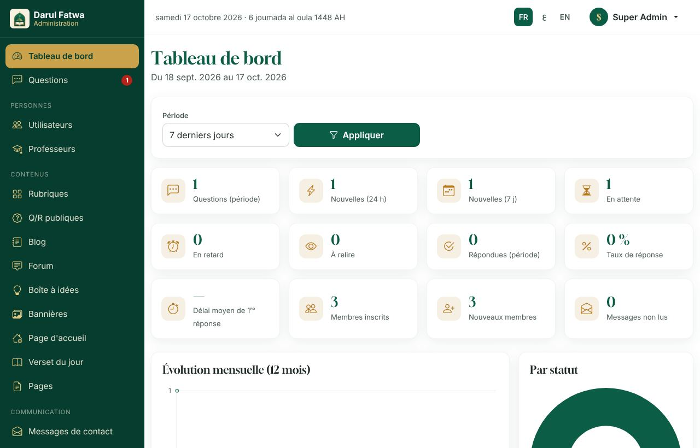

- **Cartes** : questions nouvelles, en cours, en retard (au-delà de 72 h par défaut), réponses à relire, membres, articles.
- **Graphiques** : questions par jour, par rubrique, par langue, délais de réponse ; filtre de période en haut à droite.
- **Listes** : dernières questions et réponses en attente de relecture, avec accès direct.

---

## 2. Questions

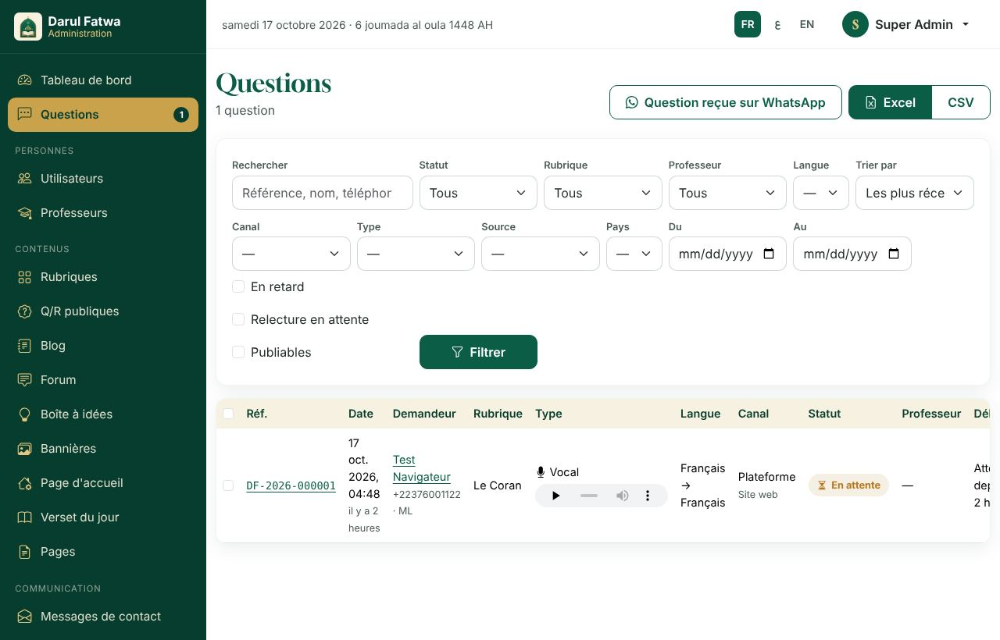

**Filtres** : statut, rubrique, professeur, langue, type (vocal / écrit), canal, période, recherche par référence ou texte.
**Tris** : plus récentes, plus anciennes, en retard, statut, rubrique, professeur. **Actions groupées** : assigner, changer le statut, exporter.

### 2.1 Fiche d'une question

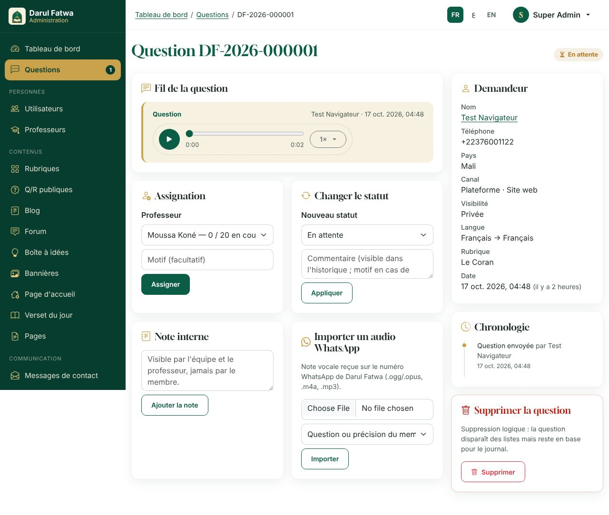

- **En-tête** : référence `DF-AAAA-NNNNNN`, statut, rubrique, langue, canal de réponse choisi par le membre, demandeur (nom réel visible pour l'administration seulement).
- **Fil** : message vocal ou écrit du membre, précisions, réponses du professeur, notes internes (jamais visibles du membre).
- **Assigner** : choisissez un professeur de la rubrique (sa charge actuelle est affichée) ; il est notifié.
  Si le membre a **demandé un professeur précis**, la fiche l'indique (étoile) : la question lui a été attribuée automatiquement s'il était disponible,
  sinon elle reste à assigner et ce professeur peut aussi la prendre lui-même.
- **Relecture** : quand un professeur « soumis à relecture » répond, sa réponse apparaît ici en attente. *Valider* la rend visible au membre ;
  *Refuser* la renvoie au professeur avec votre commentaire (note interne).
- **Statuts** : nouvelle → assignée → en cours → (précision demandée) → répondue → clôturée ; *Rejeter* avec motif courtois ; chaque changement est journalisé et notifié.
- **Publier en Q/R** : depuis une question *répondue* dont le membre a accepté la publication : reformulez la question de façon anonyme,
  choisissez la rubrique, la langue, éventuellement l'audio **du professeur** (jamais celui du demandeur). La Q/R passe en brouillon puis *Publié*.
- **WhatsApp** : si le membre a choisi ce canal, le numéro et le lien `wa.me` sont disponibles ; importez un vocal reçu sur WhatsApp dans la question avec *Importer un audio*.

### 2.2 Export

*Exporter* (en haut de la liste) : CSV (Excel francophone, UTF-8) ou XLSX, avec les filtres en cours, 5 000 lignes maximum. Les fichiers sont supprimés après 24 h.

---

## 3. Utilisateurs et professeurs

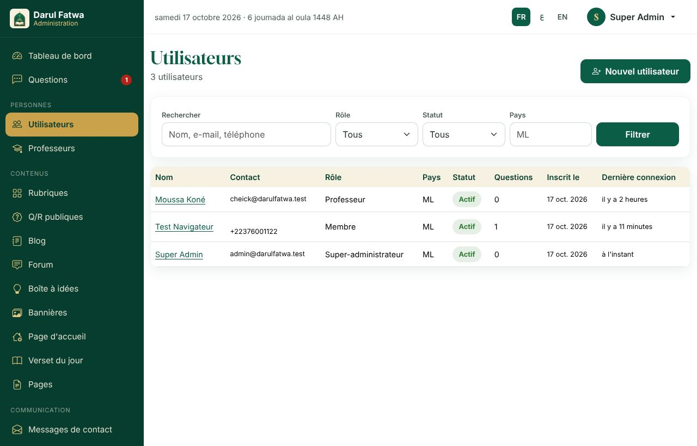

- **Utilisateurs** : recherche (nom, e-mail, téléphone), filtre par rôle et statut ; fiche avec historique, questions, suspension, suppression (RGPD : les questions privées sont supprimées, les Q/R publiées restent anonymes).
- **Créer un compte** (professeur, modérateur, administrateur ou membre) : *Nouveau* → nom, e-mail et/ou téléphone, rôle.
  Le compte est créé **en attente** et une **invitation** est générée : un **lien d'activation** et un **code à 6 chiffres**.
  - Si le compte a un e-mail, l'invitation lui est envoyée automatiquement.
  - Dans tous les cas, le lien et le code s'affichent **une seule fois** sur la fiche, avec un bouton *Envoyer par WhatsApp* (si un numéro est connu) et *Copier le message complet*.
  - La personne ouvre le lien, saisit **son identifiant** (l'e-mail ou le téléphone que vous avez enregistré) et **le code**, choisit son mot de passe, et arrive directement dans son espace (professeur → espace professeur ; modérateur et administrateur → administration).
  - L'invitation est valable 7 jours ; *Nouveau lien d'activation* (fiche du compte) en génère une autre et annule la précédente. Tant que le compte n'est pas activé, aucune connexion n'est possible.

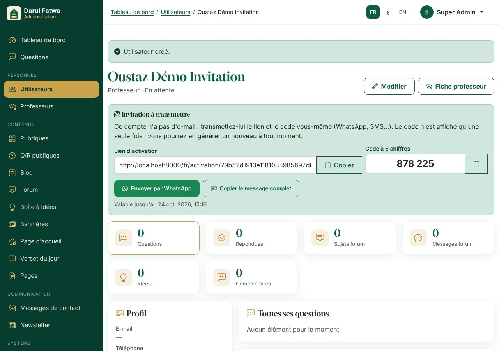

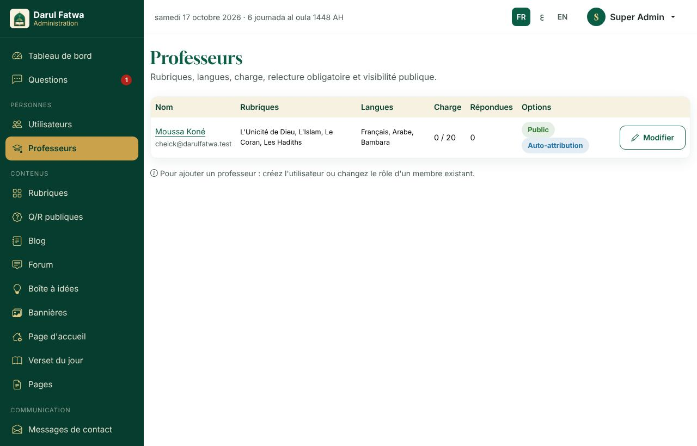

- **Professeurs** : pour chaque professeur, *Modifier* permet de régler : rubriques prises en charge, langues de réponse, charge maximale,
  **auto-attribution** (peut prendre lui-même une question nouvelle de ses rubriques), **relecture obligatoire** (ses réponses passent par vous),
  disponibilité (congés), **profil public** (photo, titre, biographie en FR/AR/EN) affiché sur « Nos professeurs ».
- Pour transformer un membre en professeur : *Utilisateurs → fiche → Rôle : professeur*, puis compléter sa fiche dans *Professeurs*.

---

## 4. Contenus

### 4.1 Rubriques
Nom, description courte et longue, texte SEO en trois langues ; icône ; ordre ; activation. Les six rubriques de départ structurent les questions, le forum et les Q/R.

### 4.2 Q/R publiques
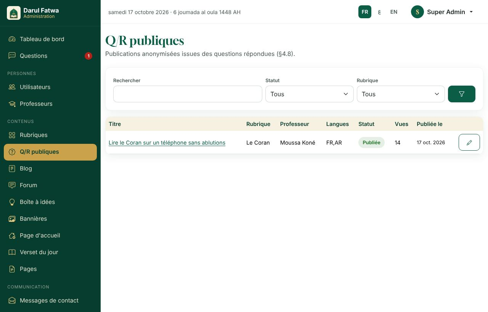
Liste des questions-réponses publiées, brouillons et archivées ; création depuis une question (voir 2.1) ou directement ; traduction par langue ; mise en avant.

### 4.3 Blog
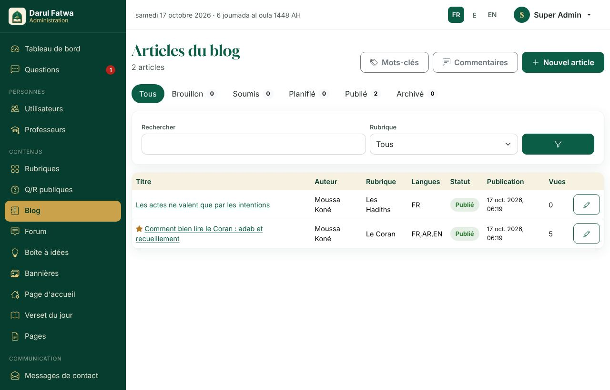
- Un article existe en 1 à 3 langues (onglets FR / AR / EN) ; champs : titre, extrait, contenu riche (éditeur), image de couverture (WebP automatique), tags, auteur (professeur), rubrique, SEO.
- **Statuts** : brouillon → soumis (par un professeur) → **publié** / **planifié** (date et heure : publication automatique par le cron) / archivé.
- Les trois articles installés avec le site sont en brouillon : relisez-les, complétez-les, puis publiez-les.

### 4.4 Commentaires
Modération a priori : chaque commentaire (blog, Q/R) attend votre approbation. *Approuver*, *Rejeter*, *Supprimer*.

### 4.5 Bannières, page d'accueil, verset du jour, pages
- **Bannières** : images (bureau et mobile), titre, texte, bouton ; ordre ; période d'affichage.
- **Page d'accueil** : activez, désactivez et ordonnez les sections (Hero, question vocale, rubriques, dernières Q/R, professeurs, blog, chiffres clés, forum et idées, newsletter).
- **Verset du jour** : texte arabe, traduction, référence, par jour.
- **Pages** : À propos, FAQ, Conditions, Confidentialité, Charte du forum… en trois langues, avec SEO.

---

## 5. Communauté

### 5.1 Forum
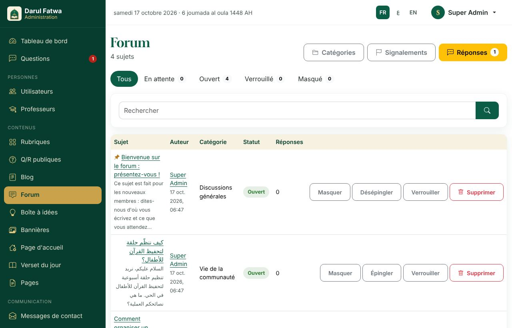
- Onglets *Sujets* (en attente, ouverts, verrouillés, masqués) et *Réponses* ; recherche.
- **File de modération** : les trois premières contributions d'un nouveau membre et tout message contenant un mot interdit attendent ici.
  *Approuver* publie (et notifie l'auteur), *Masquer* retire le contenu.
- Épingler, verrouiller, déplacer, supprimer un sujet ; gérer les **catégories** (noms en trois langues, ordre, activation).
- Réglages dans *Paramètres → Forum* : nombre de premiers messages modérés (3 par défaut, 0 pour désactiver), liste des mots interdits.

### 5.2 Signalements
Chaque signalement (sujet, réponse, commentaire, idée) indique le motif et le signalant. *Résoudre* (sans action), *Masquer le contenu*, *Rejeter*.

### 5.3 Boîte à idées
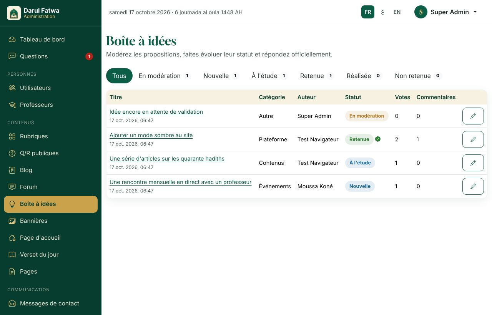
Une idée proposée est **en attente** jusqu'à ce que vous la passiez en *Nouvelle* (publique et votable). Statuts : nouvelle, à l'étude, retenue, réalisée, refusée ;
**réponse officielle** affichée sous l'idée ; l'auteur est notifié à chaque changement. Les commentaires suivent les règles du forum.

---

## 6. Communication

- **Messages de contact** : lecture, réponse par e-mail depuis l'interface, archivage.
- **Newsletter** : abonnés confirmés (double opt-in), export CSV, désinscription.
- **Notifications** : chaque membre reçoit les notifications dans son espace et par e-mail (file d'envoi traitée chaque minute par le cron).

---

## 7. Paramètres

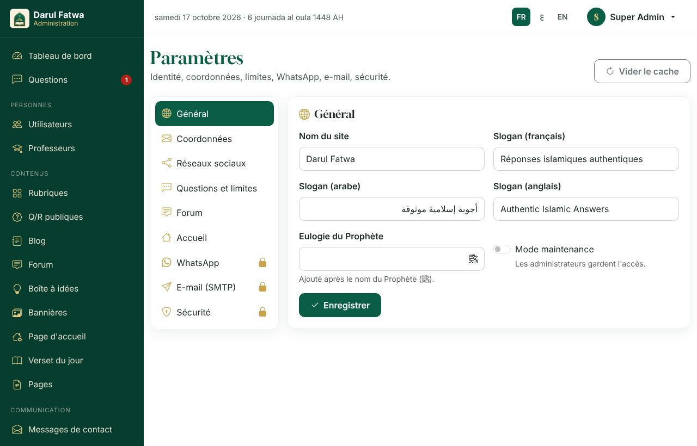

| Groupe | Contenu |
|---|---|
| Général | nom du site, slogans, mode maintenance, formule honorifique |
| Contact | e-mail, téléphone, adresse, horaires (affichés sur le site) |
| Réseaux sociaux | liens du pied de page (repris dans les données structurées) |
| Questions | durée maximale d'un vocal, taille maximale, questions par jour, délai de retard, clôture automatique, auto-attribution |
| Forum | messages modérés, mots interdits |
| Accueil | chiffres clés affichés |
| WhatsApp * | numéro officiel, mode (liens `wa.me` en V1), identifiants Cloud API (V2) |
| Courrier * | serveur SMTP, port, chiffrement, identifiants, expéditeur |
| Sécurité * | clés Cloudflare Turnstile (anti-robots) |

\* réservé au super-administrateur ; les mots de passe et jetons sont **chiffrés** en base et jamais réaffichés.

**Mode maintenance** : case dans *Général* (ou fichier `storage/maintenance.flag`) ; les administrateurs connectés conservent l'accès.

---

## 8. Journal et sauvegardes

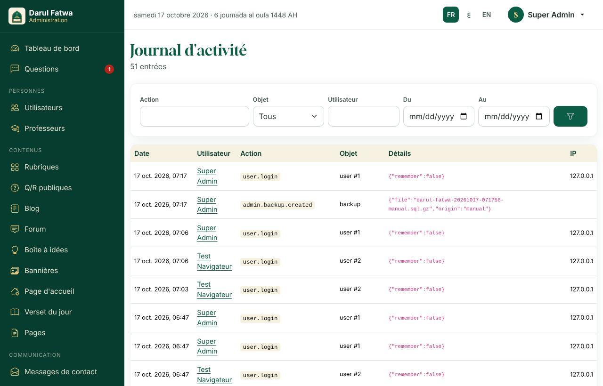

- **Journal d'activité** : qui a fait quoi, quand (connexions, changements de statut, publications, modération, paramètres…), filtrable, exportable.
- **Sauvegardes** (super-administrateur) : liste des sauvegardes de la base (quotidiennes à 01:00, 14 jours conservés) et des archives audio hebdomadaires ;
  *Sauvegarder maintenant*, télécharger, supprimer. Téléchargez-les régulièrement hors du serveur. Restauration : voir `docs/DEPLOIEMENT.md` §5.

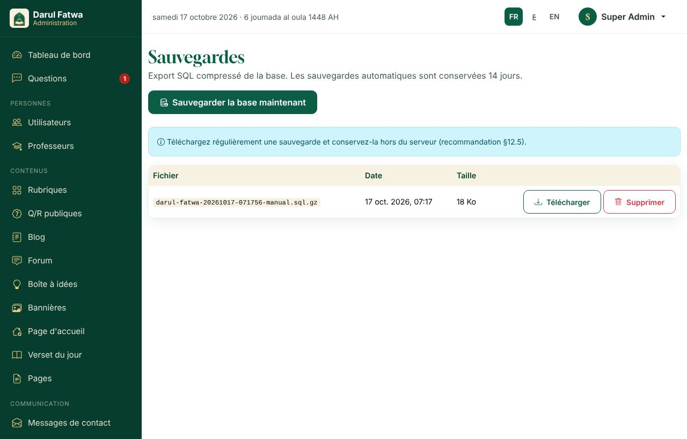

- **Système** (super-administrateur) : état de l'installation (PHP, base de données, tables, dossiers inscriptibles, ressources
  construites, dernière exécution des tâches planifiées) et **mises à jour de la base de données**. Après chaque déploiement
  depuis GitHub, cliquez *Appliquer les mises à jour* si la page (ou le bandeau orange du tableau de bord) signale des
  migrations en attente : sans cela, les nouvelles fonctions répondent par une erreur 500.

---

## 9. Bonnes pratiques

- Ne publiez **jamais** une donnée personnelle ni la voix d'un demandeur (la publication en Q/R reformule et anonymise).
- Vérifiez le tableau de bord chaque jour : questions en retard, réponses à relire, forum en attente, signalements.
- Un mot de passe par personne ; retirez les accès (statut *suspendu*) dès qu'un collaborateur quitte l'équipe.
- Gardez `APP_DEBUG=false` en production ; consultez `storage/logs/` en cas de problème.
