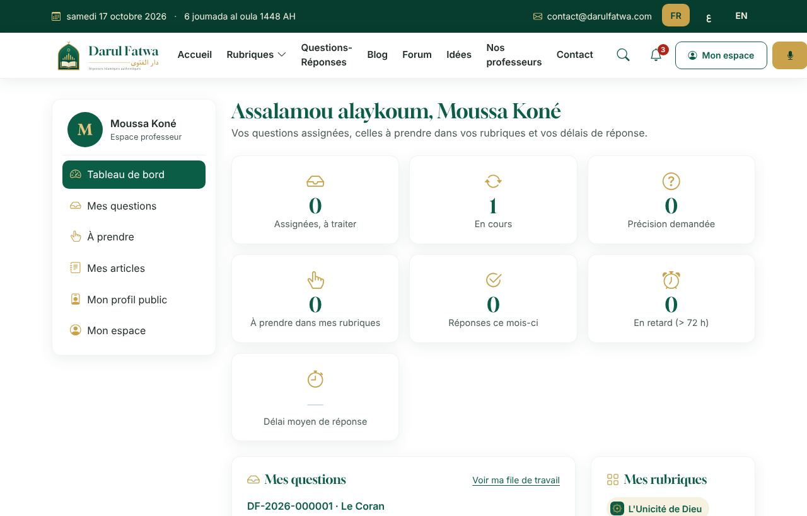
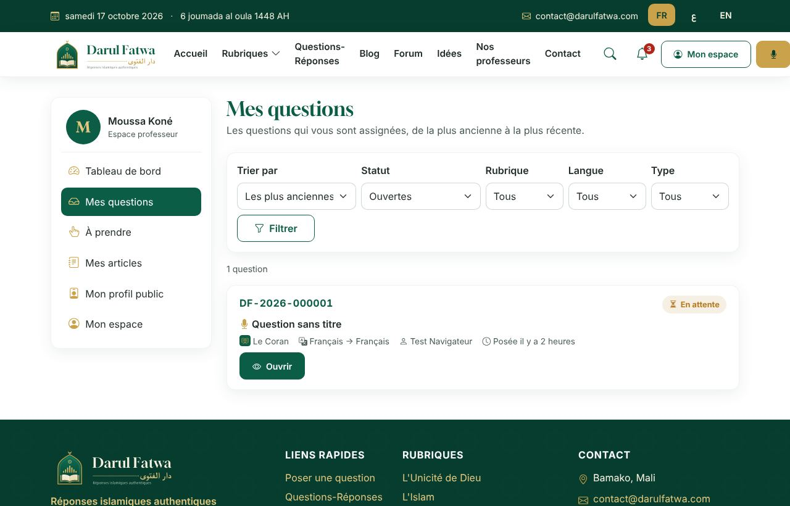
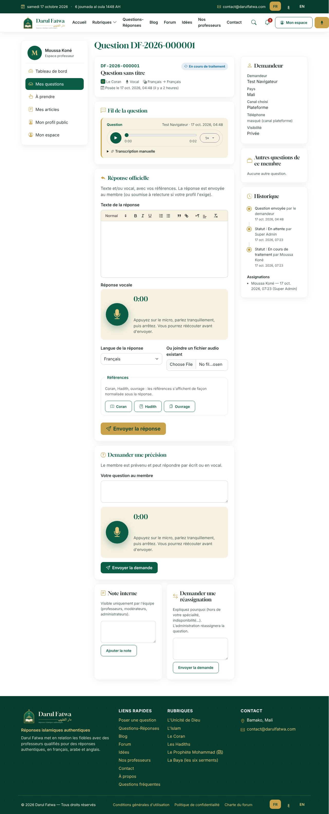
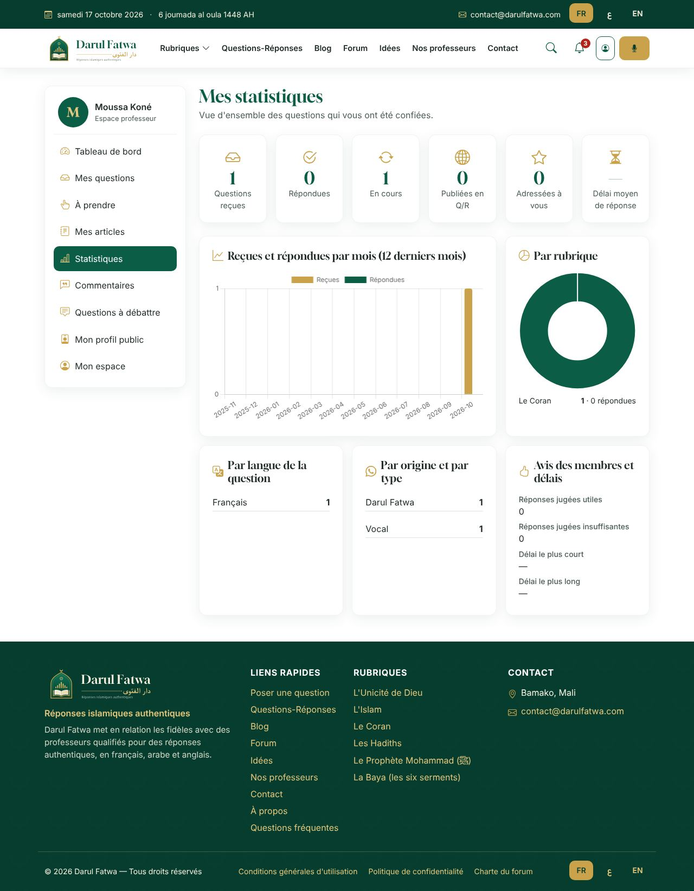
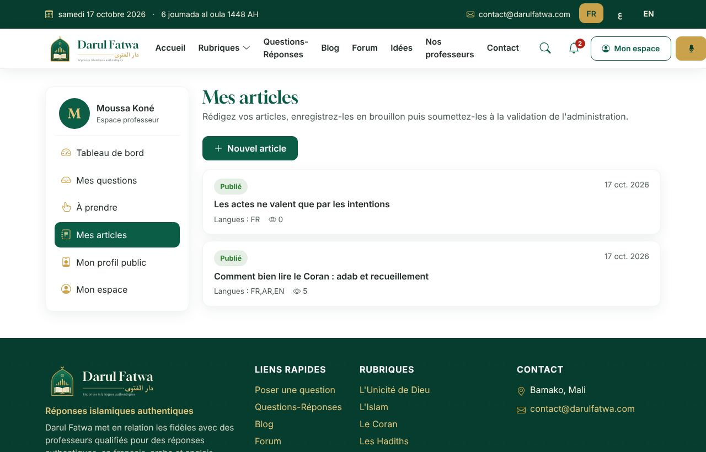
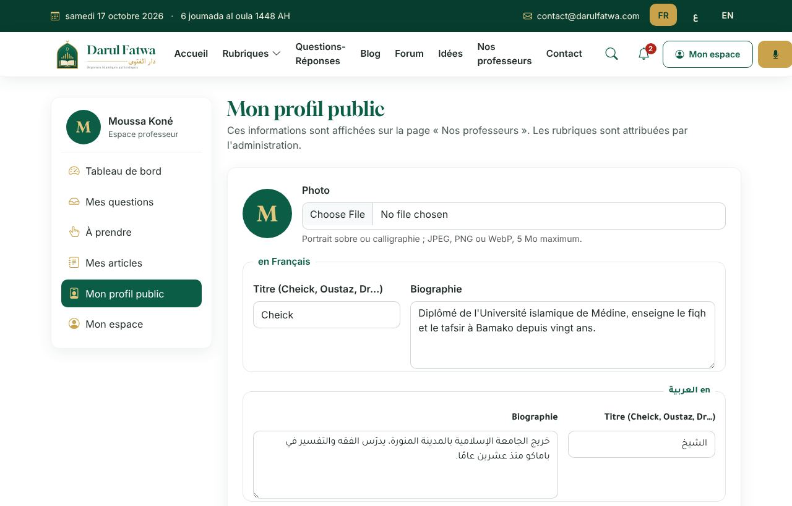

# Guide du professeur — Darul Fatwa

Bienvenue. Ce guide explique comment répondre aux questions des membres et publier des articles depuis votre
**espace professeur** : `https://votre-domaine/fr/professeur` (ou *Espace professeur* dans le menu de « Mon espace »).
L'interface existe en français, en arabe (droite à gauche) et en anglais.

---

## 1. Votre tableau de bord

- Questions **à traiter**, **en cours**, **en attente de précision**, **répondues** ; questions en retard signalées en rouge.
- Vos derniers échanges et vos articles.
- Rappel : seuls les professeurs validés par l'administration répondent au nom de Darul Fatwa.
- En tant que professeur, **vous ne posez pas de questions** : le bouton « Poser une question » du site n'apparaît pas pour vous.
  Aucune page publique ne mène à l'espace professeur : vous y accédez par le lien d'activation reçu de l'administration,
  puis simplement en vous connectant (vous y arrivez directement), ou depuis le menu de *Mon espace*, qui reste disponible
  pour votre profil, vos commentaires, le forum et vos notifications.

---

## 2. Vos questions

La liste présente les questions **qui vous sont assignées** (et, si l'administration l'a autorisé, les questions nouvelles de vos rubriques
que vous pouvez prendre vous-même avec *Prendre cette question*). Filtres : statut, rubrique, langue, type (vocal / écrit) ; tris : priorité, date.

### 2.1 Confidentialité

- Vous ne voyez **jamais le nom réel** du demandeur : seulement son pseudonyme (ou « le demandeur »), son pays et sa langue.
- Son numéro de téléphone est **masqué** (`+223 •• •• •• 12`), sauf s'il a choisi d'être répondu sur **WhatsApp**.
- Les questions sont privées ; leur publication éventuelle (anonymisée) est décidée par l'administration avec l'accord du membre.

### 2.2 Lire une question

- **Vocal** : lecteur audio (lecture, pause, vitesse 0,75× à 2×, déplacement dans l'enregistrement) ; durée et langue indiquées.
- **Écrit** : texte affiché dans sa direction (arabe à droite).
- **Fil** : précisions du membre, vos messages, notes internes de l'équipe.
- Ouvrir une question assignée la passe automatiquement **en cours**.

### 2.3 Répondre

1. **Demander une précision** si la question est incomplète : le membre est notifié, la question passe en *précision demandée* et revient *en cours* à sa réponse.
2. **Répondre** : éditeur de texte riche (titres, listes, citations, texte arabe avec `lang="ar"`) **et/ou** réponse vocale (enregistrement dans le navigateur, 5 minutes maximum par défaut, réécoute avant envoi).
3. **Références** : citez autant que possible le Coran (sourate, verset), le hadith (recueil, numéro) et les ouvrages. La mention
   « Cette réponse est donnée par un professeur de Darul Fatwa… » est ajoutée automatiquement.
4. **Envoyer** : la question passe à *répondue* ; le membre reçoit une notification (espace, e-mail, et WhatsApp si c'est son canal).
   - Si l'administration a activé la **relecture obligatoire** pour votre compte, votre réponse est d'abord **relue** : le membre ne la voit qu'après validation.
     En cas de refus, vous recevez une note interne et pouvez corriger.
5. **Canal WhatsApp** : si le membre l'a choisi, le bouton *Répondre sur WhatsApp* ouvre une conversation `wa.me` avec un message pré-rempli
   dans sa langue ; cliquez ensuite sur *Marquer comme envoyé* pour que l'échange soit journalisé.

### 2.4 Autres actions

- **Note interne** : visible uniquement par l'équipe (jamais par le membre).
- **Demander une réassignation** : si la question sort de vos compétences, indiquez le motif ; l'administration la confie à un autre professeur.
- **Proposer la publication** : si la réponse a un intérêt général, proposez-la en Q/R publique ; l'administration reformule et anonymise avant publication.

---

### 2.5 Répondre en privé ou en public

Sous le formulaire de réponse, si le membre a accepté la publication anonyme de sa question, cochez **« Réponse publique : proposer en questions-réponses »** :
votre réponse part au membre comme d'habitude **et** une proposition de publication est transmise à l'administration, qui reformule la question sans
aucune donnée personnelle avant de la publier. Si le membre a gardé sa question privée, seule la réponse privée est possible (la fiche l'indique).

### 2.6 Ce que la fiche vous indique

- **Qui** a posé la question : tant que vous n'avez pas répondu, seulement le pseudonyme choisi par le membre (ou « le demandeur ») ; **une fois votre réponse envoyée, son nom réel apparaît** sur cette question, dans le fil et dans votre file. Son pays, sa langue, et **quand** il a posé la question (date et heure, ancienneté).
- **L'origine** : question posée sur Darul Fatwa, reçue sur **WhatsApp**, ou saisie par l'administration.
- **« Adressée à vous »** : le membre vous a choisi en posant sa question. Elle vous est **attribuée directement** et apparaît dans
  *Mes questions* (l'administration la voit aussi et peut la réattribuer). Si l'administration la remet dans la file, elle reste
  visible pour vous dans *À prendre*, même si l'auto-attribution n'est pas activée pour votre compte.

## 3. Le forum

- Vous pouvez répondre aux sujets du forum comme tout membre ; vos messages portent le badge **Professeur**.
- Le bouton **Valider cette réponse** marque une réponse (la vôtre ou celle d'un autre) comme *validée par un professeur* : c'est le seul contenu
  du forum qui a valeur d'avis religieux, et le site le rappelle en haut de chaque page du forum.
- Signalez tout contenu contraire à la charte (bouton *Signaler*).

---

## 3 bis. Questions à débattre, commentaires, statistiques

- **Questions à débattre** : depuis votre espace, proposez une question à la communauté (c'est un sujet de forum signé « Professeur ») et retrouvez tous vos sujets avec le nombre de réponses.
- **Commentaires** : tout ce que les lecteurs écrivent sous vos articles et vos questions-réponses publiées, avec le lien vers le contenu ; la modération reste assurée par l'équipe.
- **Statistiques** : questions reçues, répondues, en cours, publiées, adressées à vous ; délai moyen (et plus court / plus long) de réponse ; évolution mensuelle ; répartition par rubrique, par langue, par origine (Darul Fatwa / WhatsApp) et par type (vocal / écrit) ; avis des membres sur vos réponses.

## 4. Vos articles

1. *Nouvel article* : titre, extrait, contenu (éditeur riche), image de couverture, rubrique, tags, en une ou plusieurs langues (onglets FR / AR / EN).
2. Enregistrez en **brouillon** autant que nécessaire, puis **Soumettre** : l'administration relit, met en forme si besoin, et **publie** (ou planifie la publication).
3. Un article publié n'est plus modifiable par son auteur : demandez une correction à l'administration.
4. Les commentaires des lecteurs sont modérés par l'équipe.

---

## 5. Votre profil public

Photo (recadrée et convertie automatiquement), titre (Cheick, Oustaz, Dr…), biographie en FR / AR / EN, langues de réponse, disponibilité.
Si l'administration a activé *profil public*, votre fiche apparaît sur **Nos professeurs** et sous vos réponses publiées.

---

## 6. Notifications et bonnes pratiques

- Vous êtes notifié (espace + e-mail) à chaque assignation, précision reçue, refus de relecture, rappel de retard (72 h par défaut).
- Répondez d'abord aux questions **en retard** et aux **précisions reçues**.
- Préférez une réponse courte, sourcée et bienveillante ; invitez le membre à consulter un savant local pour une situation personnelle complexe.
- Respectez les formules d'usage (ﷺ, qu'Allah l'agrée…) ; aucune image de prophète ou de compagnon.
- Ne communiquez jamais hors plateforme avec un membre en dehors du canal WhatsApp qu'il a lui-même choisi.
